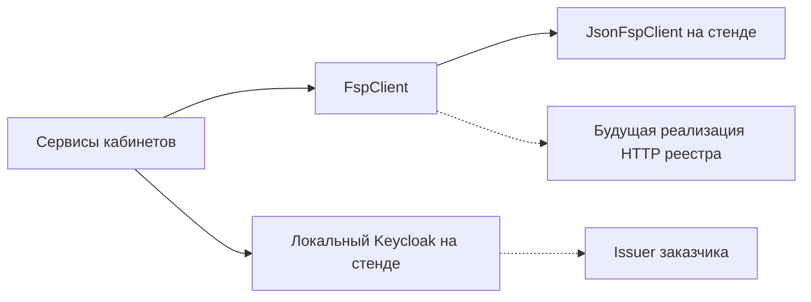

# Сопроводительная записка

Авторы: Чистяков Евгений, Иван Курлыков, Леонид Пластуненко, Николай Кузнецов, Игорь Софронов.

Прототип агрегатора ИТ-вакансий с профилем достижений Федерации спортивного программирования. Стенд — один процесс. Боевого реестра на нём нет.

## Архитектура

Монолит Python 3.12 в каталоге `product`. Три слоя живут в одном процессе uvicorn с одним worker:

- Веб: Jinja2 и локальный htmx. Страницы `/auth`, `/candidate`, `/employer`. Файл htmx лежит в репозитории, ссылок на CDN нет. В светлой шапке знак `logo_02w.svg`.
- API: FastAPI, префикс JSON `/api`. Сессия — cookie `product_session`.
- Хранилище: один файл SQLite в режиме WAL. На стенде это `/data/app.sqlite` в томе `fsp-sqlite`. Писатель один.

Подбор, тест и разбор резюме — функции в `product/matching`. Мок достижений при старте кладёт JSON из git в SQLite; кабинеты и пересчёт категории читают одни таблицы. Каталог `memory` продукт не импортирует. Отдельной СУБД и React в compose нет. Локальный Keycloak есть и в образ приложения не входит.

### Модели

В обязательном пути жюри моделей нет: категоризация, тест, подбор, разбор PDF и приглашение считаются правилами в `product/matching` и сервисами кабинетов. Разбор резюме — `pypdf` 6.19.0 и локальный словарь `stack_synonyms.json`, без внешнего вызова. Локального инференса нет, GPU на стенде нет и не требуется. Персональные данные (почта, ФИО, анкета) живут в SQLite тома стенда и за контур процесса не уходят. Если позже появится генерация заданий — только российская модель, вне обязательного пути жюри, с отдельным описанием в записке. Перечень допустимых моделей организаторы обещали отдельно, в записку его не подставляем.

## Механика теста

ТЗ §2 требует подход, устойчивый к распространению заданий и дающий сопоставимую сложность. Механика теста — `product/matching/assessment.py`. Это тот же код сборки варианта и оценки, который проверен симуляцией `product/validation_sim`.

- **Каталог-источник.** 216 вопросов (`product/matching/stems.py`), по 9 на пару «специализация × грейд», темы `refusal_contract`, `close_cause`, `offline_check`. Кандидату каталог напрямую не показывается: из него собран банк.
- **Банк семейств.** Тема одной сложности — семейство; в банке `product/validation_sim/data/bank.json` 288 семейств (6 специализаций × 4 грейда × 12). Тексты — 216 вопросов каталога `product/matching/stems.py`. Длины вариантов ответа выровнены: верный ответ самый длинный в 30% вопросов, поэтому приём «выбирай самый длинный» не работает.
- **Свой вариант по единому плану.** Тест на грейд g — 12 вопросов: 3 уровня ниже, 6 уровня g, 3 уровня выше (у junior и lead недостающие позиции добираются своим уровнем). Темы и сложность у всех одинаковые, конкретные вопросы и порядок — свои. Пересдача берёт другие темы, частота показа выравнивается по платформе.
- **Ключ только на сервере.** Варианты ответа перемешаны и получают одноразовые id; ключ лежит в записи попытки (`test_attempts.form_json`) и в API не уходит. Буквы правильного ответа нет.
- **Формат «оцените каждый вариант».** Кандидат отмечает каждый из трёх вариантов «верно» или «неверно»; вопрос засчитан, только если все три оценки правильные. Угадать — 1 из 8, а не 1 из 3. Вопросы идут по одному, вернуться к отвеченному нельзя, ответ сохраняется сразу.
- **Оценка уровня.** Уровень θ считается по модели IRT с учётом сложности каждого вопроса — разные варианты сравнимы. Если результат у границы грейдов (вероятность 15–85%), тест добавляет блок из вопросов сложности этой границы (до трёх блоков).
- **Решение.** Грейд подтверждается при уверенности не ниже 60% (осторожный порог: завысить хуже, чем занизить). Итог — `confirm`, `suggest_higher` или `suggest_lower`; принудительного понижения нет. Ответы двух предыдущих попыток этой специализации учитываются (накопление), поэтому цепочка «тест → ниже/выше» не начинается с нуля.
- **Результат с уверенностью.** Кроме итога тест сообщает уверенность, статус «уверенно» или «у границы» и положение в грейде (нижняя, средняя, верхняя треть). Порог «уверенно» (0.9) и выведенные слабые темы (32 из 216) получены на отдельной пилотной группе — `product/validation_sim/data/pilot_live.json`.

Смена грейда. Соседний грейд сдаётся отдельной попыткой и только если последняя попытка записанной пары предложила именно этот шаг. Повтор ограничен интервалом из правил: на стенде 90 дней. Интервал держится на повторной смене после того, как тест уже записал новый грейд. Первая соседняя попытка вверх после `suggest_higher` и вниз после `suggest_lower` интервал не ждёт, пока соседний `confirm` не сдвинул записанный грейд (Q&A: «провал и уход ниже — без сжигания попытки»). Повтор теста записанного грейда интервал не ждёт. Записанный грейд меняет лишь соседняя попытка с итогом `confirm`.

Несколько описаний вакансий (`product/matching/vacancies/samples.json`) показывают, как вакансия превращается в тест: она задаёт специализацию и грейд, а план 3/6/3 — какие уровни войдут в вариант. Текст вакансии вопросы не выбирает.

## Подбор и категоризация

Категория — специализация и записанный грейд, например `backend:middle`. Отрасль MVP только `it`: она видна в статусе профиля и в `category_id` не входит. Версия правил — `v1`. Рядом хранится короткое объяснение, почему категория такая.

Ранг внутри категории — один проход `evaluate_need` и склейка в выдаче: пять чисел потребности (стек, роль, формат, признак ФСП, токены текста), затем бонус актуальности `0` или `1`, затем `rank_key` `confirmed-score-count-prize-id`. Отдельных баллов за фильтры нет. Пустая потребность оставляет нули в кортеже и прежний порядок. Подходящих не скрываем. В выдаче работодателя опубликованный профиль совпавшей категории; без теста карточка «не подтверждён», с проваленным тестом (`suggest_lower`) — «не подтверждён тестом», обе ниже подтверждённых той же категории через префикс `rank_key`, только если бонус одинаковый; у подтверждённых карточка показывает «подтверждён уверенно» или «подтверждён, у границы», уверенность и положение в грейде; без `publication` карточки нет. Фильтр добавляет стек, роль, формат и признак достижений. Поиск по банку кандидатов (ТЗ §2.1) работает и без категории: `GET /api/employer/candidates` без `category_id` выдаёт все опубликованные профили, специализация и грейд сужают поиск по отдельности, порядок — те же семь полей: пять чисел потребности, бонус `0` или `1`, затем `rank_key`. На карточке фраза из того же прохода, почему этот человек попал в потребность, и следом сравнение с соседней карточкой: подтверждён, балл, число достижений, приз. Сырой rank_key на карточке не показан. Сортировка, ключ, доля в топе и балл грейда от этого не меняются. Резюме пишет узнанные поля с пометкой `source=resume` и пересчитывает категорию тем же правилом, что и анкета. После записанного итога теста PDF грейд не меняет. Разряд ФСП хранится строкой источника и в категорию не переводится.

Слова текста потребности короче трёх букв отбрасываются, остальные сравниваются стемами пакета `snowballstemmer` 3.1.1. Кириллица идёт русским алгоритмом, остальное — английским. Совпадение — равенство стема, не подстрока. Пустая потребность по-прежнему оставляет нули и никого не выкидывает. Словарь `stack_synonyms.json` стеммер не заменяет.

Опубликованный профиль по умолчанию показывает ФИО, стаж и достижения ФСП. В кабинете три отдельные галки: показывать работодателю ФИО, стаж и достижения. Снятая галка отдаёт на карточке пустую строку или пустой список. Выключенная публикация по-прежнему убирает карточку целиком. Согласие на обработку не дробится. От этих галок `rank_key` не меняется.

По непустому тексту потребности над списком есть подсказка: основная категория и одна запасная строка соседнего грейда, у каждой — сколько профилей опубликовано. Пустой текст подсказку не рисует. Категорию по-прежнему выбирает работодатель, подсказка выдачу не подменяет.

Свою опубликованную вакансию работодатель правит на той же строке: название, текст, категория, вилка и задание. Чужую строку сервис не отличает от отсутствующей и отвечает 404. Статус остаётся `published`, отклики остаются на том же номере.

Не чаще одного раза в 30 дней кандидат видит одно короткое задание уже опубликованной вакансии. Сдача пишет только время и не двигает балл теста и грейд. На карточке строка «последнее задание N дней назад» или «ещё не сдавал». Бонус актуальности — целое `0` или `1` сразу после пяти чисел потребности и до `rank_key`. Внутри строки ранга его нет.

Приглашение работодатель отправляет с карточки подборки: номер профиля и категория подставляются скрытыми полями. В форме — текст, название компании, способ связи компании и вилка в рублях до вычета НДФЛ. Нужны обе границы, верхняя строго больше нижней, валюта RUB. Способ связи компании соискатель видит сразу. Почта соискателя появляется у работодателя отдельным полем только после `accepted`. Открытие приглашения переводит `sent` в `seen`. Чужие доски не разбираются.

## Валидация

Прогон читает золотой набор из git и в сеть не ходит. Валидация жюри — CPU-персоны в том же `GET /validation`, без инференса и без GPU. Ожидаемые категорию, итог теста и отметку релевантности разметил человек. Функции категории и прогона эти поля не заполняют. На стенде это одно действие: ссылка «Прогон валидации», `GET /validation`, ответ `text/plain`. Порога, ниже которого прогон считается проваленным по проценту, нет.

Ниже пять строк прогона `python -m product.matching.golden_run` от 2026-10-10. Повтор запуска их не меняет: варианты теста в прогоне собираются с фиксированным seed. Набор в git: 38 синтетических профилей, 12 потребностей (`top_k=3`), 24 пары «специализация × грейд» для теста, 4 PDF резюме. Это числа запуска, не цель. Строка `grade_separation` — сколько вопросов каталога разделяют грейды и сколько всего; порога по ней нет. После неё — три строки CPU-персон на том же тесте, что в кабинете, без GPU: `sim_competent 72 72`, `sim_key_leak 3 72`, `sim_adjacent 0 72`; порога нет.

```text
category_match 38 38
outcome_match 72 72
form_stable 24 24
relevant_in_top 23 24
resume_ok 4 4
```

Первое число строки — сколько совпало или оказалось в топе, второе — сколько элементов было в запуске. Смысл строк:

- `category_match` — сколько профилей получили ожидаемую категорию;
- `outcome_match` — на вариантах теста ответы «сданы уровни до выше / до своего / только ниже» дали ожидаемый итог (`suggest_higher` / `confirm` / `suggest_lower`);
- `form_stable` — тот же вариант и те же ответы дали тот же итог и ту же оценку;
- `relevant_in_top` — сколько отмеченных релевантными попали в топ слотов этого запуска;
- `resume_ok` — сколько PDF разобрались без падения процесса;
- `grade_separation` — сколько вопросов разделяют грейды и сколько вопросов в каталоге. Это не порог и в блок выше не входит;
- `sim_competent`, `sim_key_leak`, `sim_adjacent` — CPU-персоны того же GET на 72 вариантах теста (24 пары × 3): знает всё до своего уровня; выучил чужой ключ по позициям вариантов; истинный уровень на ступень ниже заявленного. «Сдал» — тест подтвердил грейд или предложил выше. Порога нет.

### Симуляция на 500 синтетических кандидатах

Пакет `product/validation_sim` проверяет механику на 500 синтетических кандидатах с известным истинным грейдом (`data/candidates.csv`, `data/candidates.json`). Тест платформы сравнивается с эталоном «единый набор заданий» — от такого подхода предостерегает ТЗ §2 (3 вопроса, общий для всех ключ b-c-a). Вторая колонка платформы — тот же тест, когда в банк добавят вопросы форматов multi / order / numeric. Ответы моделируются IRT с ошибкой калибровки сложности; порог «уверенно» подобран на отдельной пилотной группе. Для платформы — среднее по 5 прогонам, в скобках мин–макс.

| Показатель | Единый набор | Платформа | Платформа + форматы |
| --- | --- | --- | --- |
| Грейд совпал с истинным | 58% | 82% (79–84) | 83% (82–85) |
| Точность среди «уверенно» | — | 92.7% (91–96) | 92.3% (90–95) |
| Доля «уверенно» | — | 24% | 45% |
| Ошибка больше чем на ступень | 2.4% | 0% | 0% |
| Грейд завышен | 34% | 8% | 8% |
| Тот же грейд при пересдаче | 51% | 75% | 76% |
| Сдали ступень выше своей без утечки | 58% | 10% | 9% |
| Сдали, зная ключ b-c-a / выбирая самый длинный ответ | 100% / 26% | 5% / 1% | 0% / 0% |

Точность среди «уверенно» близка к цели 93%, доля таких решений в кабинете — 24%: с 216 вопросами формата «оцените каждый вариант» тест у границы грейдов чаще говорит «у границы». С вопросами, которые трудно угадать, доля вырастает примерно до 45%. Пограничный кандидат не скрывается — работодатель видит его со статусом.

Запуск: `python -m product.validation_sim.run`. Таблицы — `product/validation_sim/out/report.md`, графики — `out/validation_charts.png`, описание и допущения — `product/validation_sim/README.md`.

### SYNTH-EVAL (1000)

Отдельный CPU-прогон 1000 живых ФИО с известным истинным грейдом. Он не подменяет `GET /validation`: золотой блок 38 выше остаётся путём жюри. PDF на тысячу нет, строка `resume_ok` честно `0 0`. В том же образе:

```text
python -m product.matching.synth_eval_run
```

Набор в git: 1000 профилей, 4 шарда, 12 потребностей, 24 пары шаблона. Числа этого запуска, не цель. Порога нет. `grade_separation` считается по каталогу стемов, `sim_*` — по тесту кабинета, 24 пары × 3, не по ответам тысячи людей. График — [`synth-eval.svg`](synth-eval.svg) и [`synth-eval.png`](synth-eval.png).

```text
category_match 1000 1000
outcome_match 1000 1000
template_stable 24 24
relevant_in_top 36 36
resume_ok 0 0
grade_separation 215 216
sim_competent 72 72
sim_key_leak 3 72
sim_adjacent 0 72
```

## Будущая интеграция с реестром ФСП

Кабинеты зависят от интерфейса `FspClient`. На стенде это чтение `participants.json`. Боевого коннектора реестра нет. Стенд поднимает локальный реалм Keycloak. Кандидат, уже вошедший по почте, связывает `external_id` из claim `fsp_external_id` или `sub`. Секрета боевой ФСП нет. На схеме локальный Keycloak — сплошной узел стенда, issuer заказчика — пунктир.



## API

Методы, тела, ответы и примеры ошибок лежат в `product/openapi.json`. На стенде те же страницы открываются в `/docs` и `/redoc` без интернета: статика Swagger UI 5.33.1 и ReDoc 2.5.4 лежит в репозитории. Схема безопасности — cookie `product_session`. Без входа закрытый метод отвечает 401. Пароли и коды подтверждения хранятся как хэш Argon2. Код подтверждения сбрасывается после 5 ошибок; вход по паролю после 5 неверных паролей подряд закрыт на 15 минут (429 `login_locked`), счётчик ведётся и для незарегистрированных адресов, поэтому ответ не раскрывает, есть ли учётная запись (ТЗ §3.5 «защита от несанкционированного доступа»). Без сессии доступны регистрация, подтверждение кода, повтор кода и вход.

Группы маршрутов: `/api/auth`, профиль и достижения соискателя, тест (старт, сдача ответов — при результате у границы ответ `status: "extra"` с дополнительными вопросами, история с уверенностью и статусом), резюме и PDF профиля, категория и выдача работодателя (по категории или по всей базе), карточка компании, приглашения, вакансии и отклик (`/api/vacancies`, отклик, одно короткое задание), `GET /validation`.

Рядом с выдачей: `GET /api/employer/category-hint` по тексту потребности, правка своей вакансии `POST /api/employer/vacancies/{id}`, предложение и сдача `GET` и `POST /api/candidate/periodic-task`. В профиле соискателя три флага `show_name`, `show_experience`, `show_achievements`.

## Библиотеки

Список снят `pip freeze` внутри образа `fsp-vacancies:local` на Python 3.12 и записан в `product/requirements.lock`. Строка `fsp-vacancies @ file:///srv/product` — так pip называет пакет, поставленный из дерева образа. Версия пакета в `product/pyproject.toml` — 1.4.0.

Прямые зависимости образа:

| Пакет | Версия |
| --- | --- |
| fastapi | 0.142.2 |
| uvicorn | 0.54.0 |
| SQLAlchemy | 2.1.3 |
| Jinja2 | 3.1.6 |
| python-multipart | 0.0.32 |
| argon2-cffi | 25.1.0 |
| itsdangerous | 2.2.0 |
| pypdf | 6.19.0 |
| reportlab | 5.0.1 |
| cryptography | 46.0.7 (в `pyproject.toml` — `>=44,<47`; нужна для проверки подписи токена ФСП ID) |
| snowballstemmer | 3.1.1 |
| pytest | 8.4.2 |
| httpx | 0.28.1 |

pytest и httpx нужны прогону тестов в том же образе, не отдельному хостовому окружению. Транзитивные пакеты — в lock-файле, среди них starlette 1.7.0, pydantic 2.13.5, pillow 12.3.0.

Рядом, не как пакеты Python: htmx (Zero-Clause BSD, локальный файл), Swagger UI 5.33.1 (Apache-2.0), ReDoc 2.5.4 (MIT), шрифт JetBrains Mono (SIL Open Font License 1.1).

## Сборка и запуск

На хосте заранее стоят только Docker Engine и плагин Compose. Язык, пакеты и база продукта на хост не ставятся. Копировать `compose.env` не нужно: если `PRODUCT_SECRET` короче 32 символов, точка входа пишет секрет в том `/data/product_secret`. Свой секрет можно положить в `deploy/fsp/compose.env` по образцу `compose.env.example`; файл в git не входит.

```text
docker compose -f deploy/fsp/compose.yaml up --build
```

Образ собирается из `python:3.12-slim`. Зависимости ставит `pip` внутри Dockerfile. Точка входа при необходимости пишет секрет, выполняет `python -m product.seed`, затем uvicorn на порту 8000. Клиент, API и файл базы — этот процесс и том. Контейнер Keycloak слушает `127.0.0.1:8080` и не блокирует старт uvicorn. Keycloak, Pango и Node в образ приложения не входят. Кабинеты: `http://127.0.0.1:8000`.

Проверка тестов:

```text
docker compose -f deploy/fsp/compose.yaml --profile test run --rm tests
```

Прогон валидации второй командой не запускается. Его нажимают на стенде после четырёх шагов из `track/lct-fsp-vacancies/demo.md`.

## Модерация и ATS

На стенде вакансия есть и публикуется сразу со статусом `published`. Очереди `draft` → `in_review` нет: это по-прежнему концепция, не код. Когда появится модерация, новая строка не станет публичной сразу. Очередь концепции: `draft` → `in_review` → `published` или `rejected`. Публикует модератор стенда, не автор карточки. Отклик и одно короткое задание на вакансию есть и в испытание грейда не входят. Вебхука ATS, проверки ИНН и бейджа юрлица нет.

Фиктивной в этой концепции считаем вакансию без карточки компании, без способа связи, с вилкой где max не больше min, с валютой не RUB, с текстом из одной внешней ссылки, с копией уже опубликованной строки или с ролью, которая не совпадает с заявленным направлением. Такая строка не выходит в выдачу и не попадает в выгрузку.

Контракт выгрузки в ATS — снимок, не вебхук: идентификатор профиля, категория, итог теста, статус приглашения. Работодатель забирает файл или тянет тот же JSON. Входящего webhook нет, Huntflow и 1С на стенде не вызываем, ИНН и бейдж ЕГРЮЛ не проверяем (на MVP не требуется). Пункт ТЗ «будет плюсом» и критерий 7% закрываются этой схемой, не живой интеграцией.

## Что сознательно не вошло

Публичного URL нет. Кабинеты после compose — `http://127.0.0.1:8000`. Эксперты без Docker смотрят скрины и видео презентации. Вакансия, отклик и одно короткое задание на стенде есть и в испытание грейда не входят. Вебхука ATS, проверки ИНН и бейджа юрлица нет. Адаптив под телефон обязательный путь не закрывает и этот стенд не блокирует.
