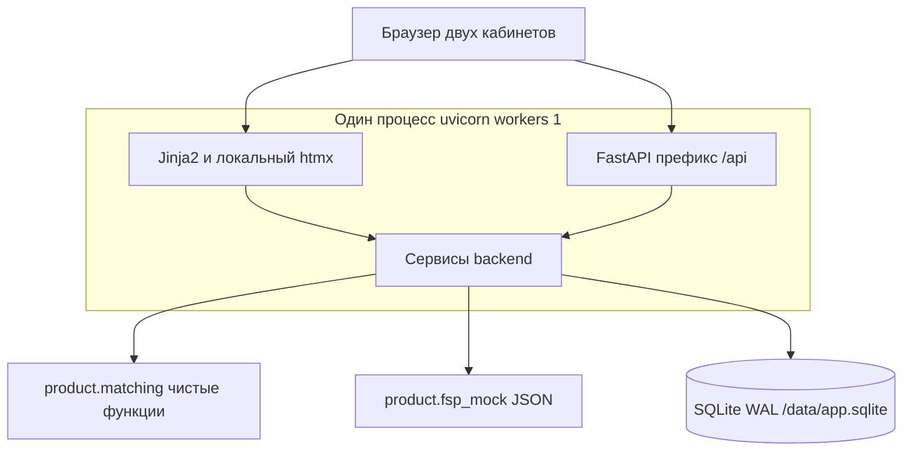
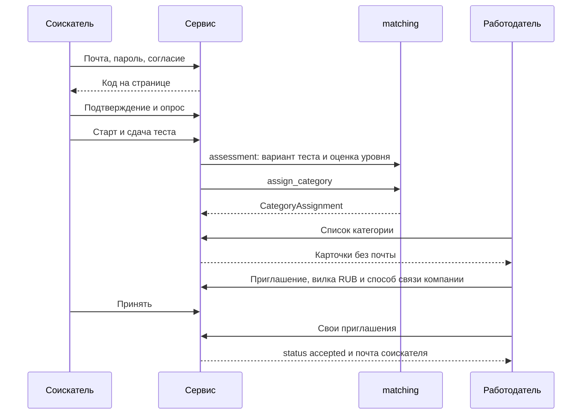
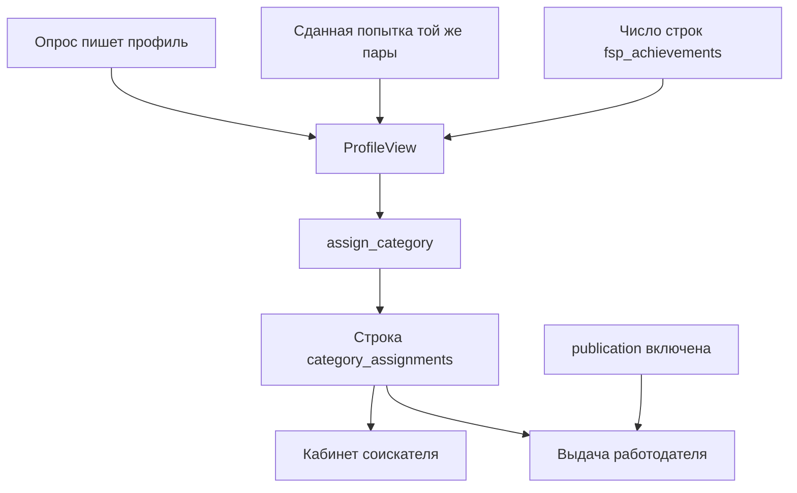
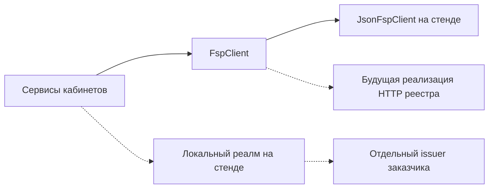

# Проектное решение: прототип агрегатора ИТ-вакансий с профилем ФСП

| | |
|---|---|
| Авторы | Чистяков Евгений, Иван Курлыков, Леонид Пластуненко, Николай Кузнецов, Игорь Софронов |
| Дата | 2026-10-05, дополнение 2026-10-06, статус полировок 2026-10-09, контракт §2.1 2026-10-11 |
| Статус | принято |
| Ветка | `main` |
| Дерево продукта | `product/` |
| Окно кода | 05–11.10.2026 |
| Стоп-код | 11.10.2026, 23:59 МСК |

Полный перечень требований ТЗ без исключений — в `track/lct-fsp-vacancies/00-postanovka.md`. Как они садятся на прототип — в `track/lct-fsp-vacancies/01-requirements.md`. Этот документ не пересказывает постановку: он фиксирует стек, каталоги, схему, контракт API и границы срезов из `track/lct-fsp-vacancies/04-plan.md`, чтобы по нему писать код. Календарь и закрытые ответы организатора здесь не копируются.

Прототип живёт в каталоге `product/`. Пакет называется `fsp-vacancies`. Кабинеты, API и хранилище собираются из этого дерева. FastAPI в зависимостях продукта — слой JSON `/api`, не чужой дашборд.

## Обзор

Нужен один веб-сервис, на котором за демо проходит сквозной путь приёмки: почта и код на стенде, профиль с отраслью, тест грейда, категория с объяснением, приглашение с вилкой в рублях и способом связи компании. Почта соискателя видна работодателю только после `accepted`. Код пишется в окне 05–11.10.2026. До этого документа стек не был выбран; оставлять его открытым нельзя: иначе параллельные срезы разъедутся по фреймворкам.

Берём монолит на Python 3.12+ в каталоге `product/`. В одном процессе три слоя: веб-клиент двух ролей (Jinja2 и локальный htmx), API FastAPI с префиксом `/api`, один файл SQLite в режиме WAL. Правила категории, теста и разбора резюме — чистые функции в `product/matching/`. Контур реестра на стенде — JSON в `product/fsp_mock/`, без HTTP. Keycloak — контейнер рядом с приложением, не пакет Python и не замена почты.

## Зачем фиксируем это сейчас

Кабинеты пишем в `product/app`, правила подбора — в `product/matching`. OpenAPI снимается с этого приложения и лежит в `product/openapi.json`. Чужой сервис в этот каталог не подмешиваем.

Приёмка требует один запуск: чистая машина с Docker Engine и плагином Compose, команда из `deploy/fsp/compose.yaml`, OpenAPI рядом с кодом и разделение на веб, API и хранилище. Язык, пакеты и база на хост не ставятся. Микросервисы, второй язык и отдельный сервер СУБД в это окно нечем окупать: пользователей десятки, боевого реестра ФСП нет, модерации нет. Стек ниже выбран один раз. До стоп-кода его можно сменить отдельным решением. После 11.10.2026, 23:59 МСК — нет.

## Цели и не-цели

### Цели

- Сквозной путь разделов «Приёмка MVP» и «Демо-скрипт» в `01-requirements.md` на стенде, без ручной правки базы по ходу сценария.
- FSP-7 (тест грейда в кабинете) внутри окна 05–11.10.2026. Без него демо не сходится.
- Два кабинета, разные префиксы страниц. Обратная механика читается с экрана: работодатель открывает категорию и шлёт приглашение, соискатель не рассылает отклики.
- Коммитируемые `product/openapi.json` и инструкция запуска. Интерактивный `/docs` открывается без интернета.
- Золотой прогон без сети. Жюри поднимает стенд одной командой compose и запускает прогон одним действием на этом стенде. В отчёт попадают только числа этого прогона: совпадения `category_id`, совпадения итога теста, совпадения «тот же шаблон — тот же грейд», доля релевантных профилей в топе и число резюме без падения. Пороги в код не зашиваются.
- Один запуск: `docker compose -f deploy/fsp/compose.yaml up --build`. На хосте только Docker Engine и плагин Compose. Второй способ (venv, pip и uvicorn на хосте) не заводим.

### Не-цели

В продукт этого окна не входят пункты «Вне скоупа» и запреты `04-plan.md`. Отдельно, чтобы не всплыли в коде:

- таксономия Блума, CAT, формула из четырёх весов, перевод дисциплин ФСП в специализации `backend` / `frontend` / `mobile` / `data` / `security` / `devops`;
- вебхук и выгрузка в ATS (Huntflow, 1С и любые другие), бейдж проверки по ЕГРЮЛ, ИНН, корпоративная почта, рейтинг работодателя;
- мастер приглашения с рыночными перцентилями, калькулятор Хабр Карьеры, «вероятность ответа», отношение границ вилки max/min, слот созвона, встречное предложение, разбор ссылки на чужую вакансию, парсинг чужих досок;
- чужие корпуса и банки задач: Mendeley, ESCO, O*NET, HumanEval, MBPP, Codeforces, корпус резюме Hugging Face. Свои шаблоны и синтетические профили ими не заменяются;
- NDCG, каппа Коэна и целевые проценты. Градаций релевантности нет: флаг бинарный, его ставит человек;
- вычисление спортивного разряда из места, перевод разряда в экономию или срок, OCR, обещание прочитать скан PDF без текстового слоя;
- Keycloak пакетом внутри монолита и вместо почты (на стенде это контейнер рядом с приложением, мок реестра без HTTP), прокторинг, чаты, обучение модели;
- веса жюри из раздела «Сдача и оценка» как константы, пороги или метрики продукта;
- парольный сброс по почте и любая внешняя почта: транспорта нет, код подтверждения показывается на странице стенда;
- обязательный адаптив в обязательный путь не входит; свои вакансии, отклик и короткое задание работодателя — это FSP-8, срез сделан: на стенде вакансия, отклик и одно короткое задание;
- второй способ запуска. Файл продукта только `deploy/fsp/compose.yaml`.

Q11 и Q13 на прототип не влияют. Их не решаем в коде.

## Устройство

### Процесс и каталоги

Один процесс `uvicorn` с `--workers 1`. Второй экземпляр приложения не поднимаем: у SQLite один писатель WAL. Асинхронный драйвер SQLite не берём.

Направление импортов одностороннее:

- `product.app` может импортировать `product.matching` и `product.fsp_mock`;
- `product.matching` не импортирует `product.app`, не открывает сокеты и не ходит в сеть;
- `product.fsp_mock` не импортирует `product.app` и тоже не ходит в сеть;
- код в `product/` импортирует только стандартную библиотеку, прямые зависимости пакета и соседние модули `product`.



Сквозной путь приёмки в этом процессе, без ручной правки базы:



Маршруты, которые трогают базу, объявляются как обычные `def`, не `async def`. FastAPI выполняет их в пуле потоков одного процесса. Сессия SQLAlchemy синхронная.

Дерево, которое создаёт каркас. Позже срезы заполняют уже заведённые файлы, а не придумывают второе дерево:

```text
product/
  pyproject.toml
  __init__.py
  paths.py
  seed.py
  export_openapi.py
  openapi.json
  README.md                 # инструкция, срез FSP-6
  app/
    main.py                 # только backend, после FSP-1 не переписывается
    log.py
    db/session.py
    db/models.py            # полная схема обязательного MVP, срез FSP-1
    api/                    # backend: auth, profiles, categories, tests, offers, resumes, validation
    services/
    web/routes.py           # frontend; backend только подключает роутер
    templates/
    static/brand.css
    static/htmx.min.js
  matching/
    types.py
    rules.py
    rules/v1.json
    category.py
    assessment.py           # тест грейда: вариант, оценка, решение (код validation_sim)
    simulate.py             # CPU-персоны прогона на том же тесте
    resume.py
    pdf_profile.py
    golden_run.py
    golden/
    need.py
    stems.py                # стемы испытаний, каталог без JSON-клонов
    stack_synonyms.json     # короткий локальный словарь стека, не корень data/
    vacancies/samples.json
  fsp_mock/
  static/fonts/             # каталог с FSP-1, ttf и OFL кладёт FSP-4
  tests/conftest.py
  var/                      # в gitignore; на стенде файл лежит в томе, не здесь
```

Рядом, не внутри пакета и не вместо операторского стека:

```text
deploy/fsp/compose.yaml       # FSP-1. Единственный файл запуска
deploy/fsp/Dockerfile
deploy/fsp/entrypoint.sh
deploy/fsp/compose.env.example
```

`product/app/templates/` — Jinja. Каталог вопросов — `product/matching/stems.py` (функция `catalog()`); из него собран банк семейств `product/validation_sim/data/bank.json`, вариант кандидату собирает `product/matching/assessment.py`.

Владение между срезами важнее постоянной таблички ролей, когда срез явно назвал файл. Постоянное правило, чтобы два среза не взяли один путь:

| Путь | Кто пишет после каркаса |
|---|---|
| `product/app/main.py`, `product/app/db/` до FSP-8, `product/app/api/` кроме файлов, отданных срезу ниже, `product/app/services/` | backend |
| `product/app/web/`, `product/app/templates/`, `product/app/static/` | frontend |
| `product/matching/` кроме `rules/v1.json`, который кладёт каркас | matching |
| `product/fsp_mock/` | backend, срез FSP-2 |
| `product/tests/test_*.py` | тот срез, который их добавляет |
| `product/tests/conftest.py` | backend в FSP-1; дальше не переписывать |

`main.py` подключает роутер кабинетов из `product/app/web/routes.py` одной строкой. Список API-роутеров живёт в `product/app/api/__init__.py` и после FSP-1 не меняется. Исключение одно: необязательный FSP-8 может дописать по одной строке импорта в `api/__init__.py` и `web/routes.py`. `main.py` не трогает и он. `models.py` замораживается на срезы FSP-1…FSP-7. Таблицы вакансий, отклика и короткого задания пишет только FSP-8, и только если срез открыт.

Внутри FSP-1 каталоги не пересекаются: backend не правит шаблоны, frontend не правит `main.py` и `db/`. Общий `conftest.py` создаёт backend: временный файл SQLite, `PRODUCT_SECRET` длиной не меньше 32 символов до импорта приложения, `TestClient`, помощник «зарегистрировать и подтвердить». Новой фикстуре место в модуле своего теста, не в `conftest.py`.

### Каркас и параллельность

Один вариант, без развилки.

FSP-1 первым коммитом создаёт пустые пакеты, `main.py`, `rules.py`, `rules/v1.json`, каталог `deploy/fsp/` и заглушки функций, которые следующие срезы заполняют. Дальше FSP-1 пишет почту и кабинеты и эти заглушки по смыслу не переписывает. Пустой слот достижений — `product/app/templates/candidate/achievements.html`, подключённый из кабинета. Обработчик кабинета сразу передаёт в шаблон результат `achievements_for(session, external_id)` из тех же таблиц SQLite, что и пересчёт категории. Пустой `external_id` даёт пустую историю: `display_name`, `rank`, `results=[]`.

FSP-2 идёт следом, не одновременно с правкой тех же файлов. Он наполняет `product/fsp_mock/` и тот же `achievements.html`. `cabinet.html`, `main.py` и модели не открывает: имя функции и переменная шаблона `fsp` уже зафиксированы.

Параллельность из `04-plan.md` остаётся только на непересекающихся путях. Пока FSP-1 делает почту и кабинеты, matching может писать чистые функции FSP-3 в `product/matching/types.py` и `product/matching/category.py`, без страниц и без `main.py`. Это можно начинать после коммита, в котором уже есть `rules/v1.json`. FSP-4 идёт параллельно FSP-3 и занимает `product/matching/resume.py`, не `category.py`. FSP-7 начинается после FSP-3 и занимает `product/matching/grade.py` и `product/matching/stems.py`. FSP-8 в плане последний и необязательный.

Заглушка, которую срез потом заполняет, — это пустое тело уже вызванной функции, а не второй необязательный реализация «если модуль импортировался». Так устроены `achievements_for`, `categories.recompute`, `load_into`.

### Веб

Префиксы страниц: `/auth`, `/candidate`, `/employer`. Чужая роль получает 403, а не чужой кабинет. Каждая запись — обычная HTML-форма с `method` и `action`, чтобы сценарий проходил и без скрипта. htmx подключается локальным файлом `product/app/static/htmx.min.js` и только подменяет фрагмент. На CDN ссылок нет.

Файл `product/app/static/brand.css` заводит ровно токены раздела «Бренд» в `01-requirements.md`. Имён сверх этого списка нет:

```css
:root {
  --fsp-blue: #402FFF;
  --fsp-red: #EC1D35;
  --fsp-light: #EDEDED;
  --fsp-gray: #C8C9CA;
  --fsp-ink: #1B1C21;
  font-family: "JetBrains Mono", ui-monospace, monospace;
}
@font-face {
  font-family: "JetBrains Mono";
  src: url("/fonts/JetBrainsMono-Regular.ttf") format("truetype");
}
```

Пока ttf нет, браузер берёт `ui-monospace`. Это не блокирует FSP-1 и не роняет процесс: каталог `product/static/fonts/` есть уже в коммите, который замораживает `main.py`, внутри лежит `README` из одной строки. `StaticFiles` с `check_dir=True` тогда видит каталог и не бросает `RuntimeError`. Сам `JetBrainsMono-Regular.ttf` и `OFL.txt` кладёт FSP-4 — первый срез, который регистрирует шрифт в PDF. Каталог `brandbook-fsp/` не коммитится. В шапку FSP-6 добавляет один `logo_02w.svg` (светлая шапка, тёмный текст, короткая подпись «ФСП»). Остальная графика брендбука на экраны не идёт.

Статика приложения смонтирована на `/static` из каталога пакета `app/static`. Шрифты лежат в каталоге пакета `static/fonts` и отдаются с `/fonts`, а не с `/static/fonts`: один `StaticFiles` на `/static` не видит второй каталог. Оба пути считаются от `Path(__file__)` пакета, не от текущего каталога и не от корня репозитория.

Фильтр работодателя не сбрасывает уже показанную подборку. Меняющиеся поля формы ничего не запрашивают. Запрос уходит только с кнопки «Показать». Ответ подменяет `#shortlist`. Ошибка 4xx подборку не стирает: htmx по умолчанию не меняет цель при ошибочном статусе.

Пустые состояния, которые рисует уже FSP-1: нет достижений при живой категории, нет приглашений, тест ещё не сдан. Подпись факта ФСП и подпись «из резюме» — разный текст, не общий бейдж.

Кабинет после FSP-1 уже содержит ссылки на тест, приглашения, слот достижений и слот статуса резюме. В кабинете работодателя там же форма карточки: название, описание, направление, контакт. Поздние срезы не переписывают `cabinet.html`, чтобы не столкнуться в одном файле. Новая разметка — в своих шаблонах: `test.html`, `offers.html`, `offer.html`, `shortlist.html`, `achievements.html`, `resume_status.html`. FSP-5 страницу карточки не заводит.

`field_boundary` уже влит: контур пустого поля, не новый токен и не новый срез. Рамка `input` текста, почты, пароля и числа, `select` и `textarea` берёт уже существующий `--fsp-ink` (`#1B1C21`), чтобы к белому фону поля было не ниже 3:1, а не `var(--fsp-gray)`. Значение `--fsp-gray` остаётся `#C8C9CA` и по-прежнему обводит секцию, форму и нижнюю границу ячейки. Чернила, кнопка и ссылка, которые уже держат 4.5:1, не перекрашиваются. Красная рамка ошибки не меняется. Второго визуального языка и нового брейкпоинта нет. Сортировка `NeedFit`, `relevant_in_top` и балл грейда от контура не зависят.

### API и OpenAPI

Приложение FastAPI. Префикс JSON — `/api`. Живой `/openapi.json` остаётся, но приёмка смотрит в коммитируемый `product/openapi.json`. Его пишет `python -m product.export_openapi` из `app.openapi()`. Файл появляется в FSP-1 рядом с командой. Срезы, которые могут идти рядом и добавляют маршруты, — FSP-3, FSP-4, FSP-5 и FSP-7 — этот файл не занимают и в своих ветках его не коммитят. После того как срез оказался в `main`, один запуск `python -m product.export_openapi` переписывает файл. Это отдельный коммит уже на `main`, не вторая правка внутри ветки, которая ещё открыта рядом с другой. Тест `test_openapi.py` сравнивает файл с результатом функции и падает при расхождении. Его гоняют после этой перегенерации, а не как повод каждой параллельной ветке нести свою копию. JSON руками не правят. FSP-6 делает последнюю такую генерацию к сдаче, когда обязательные маршруты уже в `main`. Тот же порядок у FSP-8, если его откроют: ветка файл не берёт, перегенерация — после слияния в `main`.

`docs_url` и `redoc_url` у конструктора выключены. Свои страницы `/docs` и `/redoc` собираются через `get_swagger_ui_html` и `get_redoc_html`, а `swagger_js_url`, `swagger_css_url` и `redoc_js_url` указывают на файлы в `product/app/static/docs/`. Способ самохостинга — страница документации FastAPI «Custom docs UI assets» из раздела «Источники». Пока файлов нет, маршрут отвечает 503 `docs_assets`. Файлы кладёт FSP-6, `main.py` для этого не меняется. Тест FSP-6 открывает HTML `/docs` и проверяет, что в нём нет `cdn.jsdelivr.net`, `unpkg.com` и `fastapi.tiangolo.com`. Строки внутри vendored-скрипта не сканируем.

Показ стенда не зависит от интернета. Сеть нужна только сборке образа, когда `pip` выполняется внутри `Dockerfile`. Повторный показ `/docs` и кабинетов — нет. На хосте `pip` не запускается.

### Хранилище

На стенде файл базы — `/data/app.sqlite`. Compose монтирует именной том на `/data`, поэтому перезапуск контейнера данные не стирает. Каталог `product/var/` всё равно в корневом `.gitignore`: случайный файл рядом с исходниками в git не попадает. В git базы нет.

SQLAlchemy 2, стиль `Mapped` / `mapped_column`. Таблицы создаёт `create_all` из `python -m product.seed`, только недостающие. Alembic не берём: база синтетическая, накатывать миграции некому. Схема обязательного MVP целиком создаётся в FSP-1, включая отрасль, таблицы теста, категории, приглашений и мока. Срезы FSP-2…FSP-7 `models.py` не меняют. Своих вакансий в этой схеме нет. Колонка `vacancy_id` у приглашения есть и остаётся `NULL`, без внешнего ключа на несуществующую таблицу. Таблицы вакансии, отклика и короткого задания и ключ с `offers.vacancy_id` добавляет только FSP-8, если срез открыт; после этого том sqlite удаляют и seed создаёт файл заново.

Повторный seed не удаляет данные в томе и безопасен на базе, где строки уже есть. `create_all` создаёт только недостающие таблицы. `load_into` вставляет участника или достижение только если этого ключа ещё нет: участник по `external_id`, достижение по паре (`external_id`, `competition_id`). Существующую строку повтор не обновляет и не удаляет. Демо-пользователя seed создаёт только если задан `PRODUCT_DEMO_PASSWORD` и этой почты в `users` ещё нет; при пустой переменной людей нет. Нарушение уникального ключа пишется в журнал и не останавливает процесс: entrypoint после seed всё равно делает `exec uvicorn`. Другая ошибка seed, например база не открылась или `create_all` упал, процесс останавливает. Сброс стенда — удалить том `fsp-sqlite` и поднять compose заново: seed создаёт файл. Seed создаёт каталог с `umask 077`, включает схему и вызывает `product.fsp_mock.load.load_into`. В каркасе FSP-1 `load_into` ничего не делает. Пароль демо в репозиторий не кладём. Сценарий может обойтись без демо-пользователя и зарегистрировать соискателя через интерфейс.

Подключение:

```python
from sqlalchemy import create_engine, event
from sqlalchemy.pool import NullPool

engine = create_engine(
    sqlite_url,  # sqlite:///<абсолютный путь>
    poolclass=NullPool,
    connect_args={"check_same_thread": False, "timeout": 5.0},
)

@event.listens_for(engine, "connect")
def _sqlite_pragmas(dbapi_conn, _connection_record):
    cur = dbapi_conn.cursor()
    cur.execute("PRAGMA journal_mode=WAL")
    cur.execute("PRAGMA busy_timeout=5000")
    cur.execute("PRAGMA foreign_keys=ON")
    cur.close()
```

`check_same_thread=False` нужен из-за пула потоков одного процесса, не из-за второго экземпляра. `timeout=5.0` и `busy_timeout=5000` — один и тот же предел не меньше 5 секунд, продублирован специально. `NullPool` не держит соединение между запросами. Журнал WAL: читатели не блокируют писателя и писатель не блокирует читателей; писатель при этом один.

Ориентир SQLite для сайта низкой и средней нагрузки — консервативная оценка «меньше 100 тысяч хитов в день», не жёсткий потолок и не наш замер. Нагрузка прототипа — десятки одновременных пользователей. Отдельный замер не обещаем и число миллисекунд в код не пишем. Много процессов, которые пишут и не могут встать в очередь, у нас нет: процесс один, записи короткие. Если появится второй экземпляр приложения, замена — Postgres. В этом окне его не поднимаем.

Путь базы — переменная `PRODUCT_SQLITE`. В compose она абсолютная: `/data/app.sqlite`. Функции `repo_root()` нет: после `pip install` внутри образа `__file__` лежит в site-packages, а не в каталоге репозитория. Шаблон, шрифт и JSON правил читаются от каталога пакета. Если `PRODUCT_SQLITE` не задана, seed берёт `var/app.sqlite` рядом с пакетом; на стенде переменная задана всегда, и этот запасной путь не используется.

### Зависимости и установка

Свой проект `product/pyproject.toml`, имя дистрибутива `fsp-vacancies`, `requires-python >= 3.12`. `pip` выполняется только в `Dockerfile`. Инструкция стенда не ставит venv и не вызывает uvicorn на хосте. В образ копируется дерево `product/` и точка входа.

Каталог `product/` сам является пакетом Python (`product/__init__.py` рядом с `pyproject.toml`). Вложенный `product/product/` не создавать. Setuptools получает явную карту пакетов, чтобы не подхватить соседние каталоги репозитория:

```toml
[project]
name = "fsp-vacancies"
version = "1.4.0"
requires-python = ">=3.12"
dependencies = [
  "fastapi>=0.115,<1",
  "uvicorn==0.54.0",
  "sqlalchemy>=2,<3",
  "jinja2>=3.1,<4",
  "python-multipart>=0.0.9",
  "argon2-cffi",
  "pypdf==6.19.0",
  "reportlab==5.0.1",
]

[project.optional-dependencies]
dev = ["pytest>=8,<9", "httpx>=0.27,<1"]

[tool.setuptools]
packages = [
  "product",
  "product.app",
  "product.app.api",
  "product.app.db",
  "product.app.services",
  "product.app.web",
  "product.matching",
  "product.fsp_mock",
]

[tool.setuptools.package-dir]
product = "."

[tool.setuptools.package-data]
product = [
  "app/templates/**/*.html",
  "app/static/**/*",
  "matching/rules/*.json",
  "matching/golden/**/*",
  "matching/stack_synonyms.json",
  "matching/vacancies/*.json",
  "fsp_mock/*.json",
  "static/fonts/*",
]
```

Патч `argon2-cffi` не фиксируем: в коде стоят явные `Type.ID` и три параметра OWASP, на дефолт памяти библиотеки расчёт не опирается. Extra `uvicorn[standard]` не ставим: в образе не нужны uvloop и сборка C. Точные версии uvicorn, pypdf и reportlab — те, что сверены 2026-10-05 (раздел «Источники»). `package-data` обязателен: без него шаблоны и JSON останутся в исходниках и не попадут в site-packages образа. FSP-6 коммитит `product/requirements.lock`, снятый `pip freeze` внутри уже собранного образа. Dockerfile FSP-1 ставит зависимости из `pyproject.toml`; lock — запись того, что собралось, а не вторая команда запуска.

Команда тестов внутри контейнера `tests` — `pytest product/tests`. Контейнер тестов том `/data` не монтирует: фикстура пишет временный sqlite внутри контейнера и стенд не затирает.

`python-dotenv` не подключаем. Если `PRODUCT_SECRET` короче 32 символов, точка входа пишет секрет в `/data/product_secret` и экспортирует его: стенд стартует без `compose.env`. Свой секрет можно положить в `deploy/fsp/compose.env` — файл в git не входит. Пример — `deploy/fsp/compose.env.example`.

### Правила v1

Файл `product/matching/rules/v1.json` создаёт каркас и больше не меняет. В нём:

- `rule_version`: `v1`;
- `grade_change_interval_days`: `90` (пример «три месяца» из ТЗ хранится числом дней);
- отрасль: только `it`. Других отраслей на MVP нет. В `category_id` не входит и в `ProfileView` не передаётся;
- специализации и грейды из раздела «Профиль» требований: `backend`, `frontend`, `mobile`, `data`, `security`, `devops` и `junior`, `middle`, `senior`, `lead`;
- формат: `офис`, `удалённо`, `гибрид`;
- стек, софт-скиллы и роль в компании — закрытые списки прототипа, потому что в требованиях это метки, а не абзац, но сами метки не перечислены. Стек: `python`, `java`, `go`, `javascript`, `typescript`, `kotlin`, `swift`, `sql`, `linux`, `docker`. Софт-скиллы: `коммуникация`, `менторство`, `письменный текст`, `приоритизация`. Роль в компании: `разработчик`, `тимлид`, `аналитик`.

Неизвестное значение списка не угадывается по созвучию и поле не заполняет. Стаж — строка, как ввёл человек. Роль на соревновании в эти три значения не входит и в том же столбце не хранится.

Короткий словарь синонимов стека — `product/matching/stack_synonyms.json`. Он в git, на прогоне не скачивается и наружу не зовёт. Ключ — написание в нижнем регистре, значение — метка закрытого списка v1, например `py` → `python`, `js` → `javascript`. Разбор строки «Стек» сверяется со словарём до закрытого списка. Чего нет ни там, ни в списке, поле не заполняет. Это не ESCO и не O*NET. Синонимы дисциплин ФСП остаются в адаптере мока и в этот файл не переносятся. Второго корня `data/` в репозитории нет: фикстуры лежат только в уже названных каталогах `product/`. Том `/data` в контейнере — это файл sqlite, не каталог фикстур.

`category_id` — строка `{specialization}:{grade}`, например `backend:middle`. Символа `/` в ней нет.

Порядок грейдов для соседнего шага: `junior`, `middle`, `senior`, `lead`.

### Категория

Сигнатура, которую реализует `product/matching/category.py`:

```python
def assign_category(profile: ProfileView, rule_version: str) -> CategoryAssignment:
    ...
```

```python
@dataclass(frozen=True)
class ProfileView:
    profile_id: int
    specialization: str
    grade: str
    test_score: int | None
    test_outcome: str | None  # confirm | suggest_lower | suggest_higher | None
    fsp_confirmed_count: int
    fsp_has_prize: bool = False

@dataclass(frozen=True)
class CategoryAssignment:
    profile_id: int
    category_id: str
    rule_version: str
    explanation: str
    test_score: int | None
    rank_key: str
```

В `ProfileView` нет текста резюме и нет дисциплины ФСП. Категорию они задать не могут: им некуда попасть. `category_id` собирается только из специализации и записанного грейда. `rule_version` прототипа — строка `v1`; другое значение даёт ошибку `rule_version`.

`explanation` называет опрос, итог теста и версию правил, дословно так:

- тест не сдан: `Опрос: специализация {spec}, грейд {grade}. Тест ещё не сдан. Правила {rule_version}.`
- тест сдан: `Опрос: специализация {spec}, грейд {grade}. Тест: {итог}, балл {score}. Правила {rule_version}.`

Итог по-русски: `заявленный грейд подтверждён`, `предложен грейд ниже`, `предложен грейд выше`. Разряд, дисциплина и «из резюме» в эту фразу не подставляются.

Время записи проставляет сервис в колонке таблицы в момент `INSERT`, часы UTC. В DTO matching этого поля нет: золотой набор и чистая функция категории от часов не зависят.

Ранг внутри категории после среза R1–R5: префикс подтверждения, балл теста, число подтверждённых достижений ФСП, бит призёра, номер профиля. Одинаковые люди не отфильтровываются. Последний компонент ключа только стабилизирует порядок:

```python
def rank_key(
    confirmed: bool,
    test_score: int,
    fsp_confirmed_count: int,
    has_prize: bool,
    profile_id: int,
) -> str:
    return (
        f"{int(confirmed)}-{test_score:03d}-"
        f"{fsp_confirmed_count:04d}-{int(has_prize)}-{profile_id:08d}"
    )
```

Выдача работодателя сортирует по убыванию пять чисел потребности, затем бонус актуальности `0` или `1`, затем строку `rank_key`. Сам `NeedFit.sort_key` бонус не содержит. При ещё не сданном тесте колонка `test_score` остаётся `NULL`, префикс ключа `0-`, балл в ключе 0. Опубликованный профиль после опроса в список работодателя попадает со статусом «не подтверждён» и при равном качестве потребности и равном бонусе стоит ниже сдавших той же категории. Бонус `1` выше любого `rank_key`. Ноль баллов после сдачи — это сданный тест (`1-000-…`), человек в категории остаётся. Число достижений — `COUNT(*)` строк `fsp_achievements` по `external_id`. Бит приза — есть ли `place` из `{"1","2","3"}`; `"финал"` и `"4"` не пьедестал. Дисциплины не взвешиваются, срока давности нет. Смесь старого формата `100-…` и нового `1-…` ломает DESC: после смены ключа на живом томе только `docker compose -f deploy/fsp/compose.yaml down -v`.

Текущая строка категории — с максимальным `id` для пары (`profile_id`, `rule_version`). История строк не стирается.



Резюме и дисциплина в этот поток не входят. После опроса сервис пишет назначение сразу: кабинет соискателя показывает `category_id` и объяснение, это закрывает FSP-3. В выдачу работодателя строка попадает при согласии на публикацию, в том числе до теста: на карточке статус «не подтверждён». Отсутствие теста не заполняется резюме и не заполняется фактом ФСП.

Почему человек в списке работодателя: сохранённое `explanation` плюс `list_reason` из `NeedFit.reason`. Один проход `evaluate_need` одновременно фильтрует, собирает кортеж сортировки и эту фразу. В базу фраза не пишется. Отдельных баллов и поля `_need_score` на карточке нет.

На карточке подборки сырого `rank_key` и слова `порядок` нет. `neighbor_phrase` дописывает к уже существующему `list_reason` сравнение с соседней карточкой. К уже существующему предложению `list_reason` добавляются человеческие имена полей ключа: подтверждён, балл, число достижений, приз. Сортировка `NeedFit`, сам `rank_key`, `relevant_in_top` и балл грейда не меняются. Это не новый ранг. 59 дистракторов в это окно не входят. Периодическое задание на 30 дней даёт бонус `0` или `1` перед `rank_key`; в строку ранга и в испытание грейда он не входит.

Текст потребности — необязательная строка `q`. Сравнение без сети и без модели: стем `snowballstemmer` 3.1.1, равенство стема, не подстрока. Слова короче трёх букв отбрасываются до стемминга. Кириллица идёт русским алгоритмом, остальное — английским. Пустой запрос никого не выкидывает. Словарь синонимов стека стеммер не заменяет. Похожая на URL строка наружу не ходит. По непустому тексту подсказка показывает основную категорию и одну запасную строку соседнего грейда со счётчиком опубликованных; категорию выбирает человек. На опубликованном профиле три флага видимости ФИО, стажа и достижений, по умолчанию включены; выключенная публикация по-прежнему убирает карточку. Свою вакансию работодатель правит на той же строке, статус остаётся `published`, чужая отвечает 404. Несколько меток стека в фильтре связаны по ИЛИ: достаточно одной общей метки.

Смена специализации пересчитывает категорию. Записанный грейд опрос и резюме не меняют: его пишет только подтверждённый тест соседнего грейда, раздел «Тест грейда». Сданный тест переносится в новое назначение, только если у попытки та же пара специализация и грейд. Иначе `test_score` нового назначения пустой, старые попытки остаются в истории. Отрасль в пересчёт не входит: она лежит в статусе профиля рядом с категорией.

### Тест грейда

ТЗ §2: единый набор заданий для всех не подходит, генерация нейросетью не гарантирует сопоставимую сложность. Тест собирается из банка семейств вопросов (`product/validation_sim/data/bank.json`, 288 семейств: 6 специализаций × 4 грейда × 12; тексты — 216 вопросов каталога `product/matching/stems.py`). Семейство — одна тема одной сложности. Кабинет вызывает `product/matching/assessment.py` — тонкий слой над `product/validation_sim`, тот же код, что проверен симуляцией.

- Вариант на грейд g — 12 вопросов по единому плану: 3 уровня ниже, 6 уровня g, 3 уровня выше (у junior и lead недостающее добирается своим уровнем). Темы и сложность у всех одинаковые, конкретные вопросы и порядок — свои; пересдача берёт другие семейства, частота показа выравнивается по банку.
- Формат «оцените каждый вариант»: кандидат отмечает каждый из трёх вариантов «верно» или «неверно», вопрос засчитан, только если все оценки правильные (угадать — 1 из 8). Вопросы идут по одному, вернуться к отвеченному нельзя, ответ сохраняется в черновике сразу.
- Ключ только на сервере: варианты перемешаны и получают одноразовые id, ключ хранится в `test_attempts.form_json` и в API не уходит.
- Уровень θ — IRT с учётом сложности вопроса. У границы грейдов (вероятность 15–85%) тест добавляет блок из 6 вопросов сложности этой границы, не больше трёх; API отвечает `status: "extra"`.
- Решение: грейд подтверждается при уверенности не ниже 60%; итог `confirm`, `suggest_higher` или `suggest_lower`. Две предыдущие попытки этой специализации учитываются (накопление). Итог сообщает уверенность, статус «уверенно» или «у границы» и положение в грейде. Порог «уверенно» и выведенные слабые темы — из пилота на отдельной группе (`pilot_live.json`).

Смена грейда. Тест сам грейд не снижает и не пишет в `profiles`, пока итог соседней попытки не `confirm`. Первая установка грейда — опрос, интервал на неё не действует, `grade_changed_at` заполняется. Соседний грейд сдаётся отдельной попыткой и только если последняя сдача записанной пары предложила именно этот шаг. Первая соседняя попытка в обе стороны паузу не ждёт; интервал 90 дней держится на повторной смене после того, как соседний `confirm` уже записал грейд. Повтор теста записанного грейда интервал не ждёт. Кнопок «принять грейд» нет; повторный `PUT` профиля с другим грейдом отвечает 409 `grade_via_test`.

Старт создаёт попытку `draft` или возвращает уже открытый черновик этого профиля (один черновик — частичный уникальный индекс). Черновик на другую пару даёт 409 `attempt_open`.

Рядом лежит `product/matching/vacancies/samples.json`: несколько синтетических описаний вакансий со специализацией и грейдом. Страница теста показывает, какой план 3/6/3 получит кандидат на такую вакансию; текст вакансии вопросы не выбирает.

### Золотой прогон

Фикстуры лежат в git и на прогоне не скачиваются: золотой набор в `product/matching/golden/`, стемы в `product/matching/stems.py`, описания вакансий в `product/matching/vacancies/samples.json`, словарь стека в `product/matching/stack_synonyms.json`, мок в `product/fsp_mock/`. Сеть не используется. После пяти золотых строк и `grade_separation` тот же GET печатает CPU-персоны `sim_competent`, `sim_key_leak`, `sim_adjacent`: без GPU, без инференса, порога по этим строкам нет. Жюри поднимает стенд командой compose и запускает прогон одним действием: страница `GET /validation` (одна кнопка, ответ `text/plain`, обработчик в `api/validation.py`). Та же функция — `python -m product.matching.golden_run`, в инструкцию приёмки второй командой она не выносится. Печатаются строки:

```text
category_match <совпало> <всего>
outcome_match <совпало> <всего>
form_stable <совпало> <всего>
relevant_in_top <релевантных в топе> <слотов>
resume_ok <без падения> <всего>
grade_separation <разделяющих> <всего пунктов>
sim_competent <попало> <слотов>
sim_key_leak <попало> <слотов>
sim_adjacent <попало> <слотов>
```

`cases.json` задаёт `top_k` (для прототипа 3), несколько десятков синтетических профилей и около десятка потребностей: по одной или две на специализацию. Кейс — вход `ProfileView` без резюме и дисциплины. Ожидаемый `category_id` и флаг `relevant` записывает человек; `assign_category` и сам прогон эти поля не заполняют. `outcome_match` и `form_stable` считаются на вариантах теста из банка с фиксированным seed: ответы «знает уровни до выше / до своего / только ниже» должны дать `suggest_higher` / `confirm` / `suggest_lower`, а тот же вариант с теми же ответами — тот же итог и ту же оценку. CPU-персоны `sim_*` (`product/matching/simulate.py`) проходят тот же тест: знает свой уровень, выучил чужой ключ по позициям, уровень на ступень ниже. Это не целевые проценты.

У каждой потребности человек отмечает релевантные профили. Доля считается по фактической сортировке `NeedFit.sort_key` внутри этой потребности: сколько отмеченных попало в первые `top_k`. В `relevant_in_top` пишутся суммы этого прогона: отмеченные в топе и число просмотренных слотов. Порога, ниже которого прогон «провален по проценту», нет. NDCG нет. Падение теста — это другое: не совпал ожидаемый `category_id` или ожидаемый итог, тот же вариант с теми же ответами дал другой итог или другую оценку, либо разбор PDF бросил исключение.

Дискриминативность заданий в эти пять строк не входит. Процедура считает её по каталогу вопросов, без нового набора и без ответов живых людей. Пункт разделяет грейды, если оба неверных варианта — правдоподобная ошибка соседнего нижнего грейда, а не уход в сторону: цвет, логотип, число лайков, имя дашборда и то же семейство. На `junior` нижнего соседа нет, оба неверных остаются на той же оси, грейд ниже `junior` не вводится. Счёт таких пунктов называется `grade_separation`: разделяющие и всего пунктов. Порога, ниже которого прогон провален по этому счёту, нет. Исторический единый ключ каталога (было до 1.2.12) в этом срезе не трогали, это не текущий факт. Пороги 50 и 80, три вопроса и `rule_version` v1 не меняются, четвёртый шаблон не добавляется, `cases.json` не растёт. Сортировка `NeedFit` и балл грейда от счёта не зависят. Прогон печатает `grade_separation` отдельной строкой рядом с пятью. Пороги 50 и 80 и три вопроса в этом абзаце — история среза стемов, не сдача v2 (b93f738); числа абзаца не переписываются.

`stem_axis` уже влит: тексты неверных в стемах v1, не новая строка прогона. Неверный, который уходил в сторону (бренд, цвет, логотип, число лайков, имя дашборда и то же семейство), переписан в правдоподобную ошибку по оси грейда, чтобы `is_drift` его больше не ловил. На `junior` нижнего соседа нет, оба неверных остаются на той же оси, грейд ниже `junior` не вводится. Буква ключа и текст верного варианта в этом срезе не менялись: исторический единый ключ каталога, не текущий факт (было до 1.2.12). Пороги 50 и 80, три вопроса и `rule_version` v1 не менялись, четвёртый шаблон не добавлялся, `cases.json` не рос. Счёт `grade_separation` остаётся прежней строкой, порога провала нет, число разделяющих пунктов этот документ не фиксирует. `is_drift` не подменялся, чтобы счёт вырос без смены текстов. Сортировка `NeedFit`, `relevant_in_top` и балл грейда от правки не зависят.

Отдельный тест порядка проверяет конкретные id (выше балл, затем больше достижений, оба профиля с равным баллом и равным числом достижений присутствуют). Это не процент и не замер времени.

`resumes.json` и несколько синтетических PDF с текстовым слоем добавляет FSP-4 в `product/matching/golden/resumes/`. Пока файла нет, строка `resume_ok` печатает `0/0`. Ожидаемая ошибка пустого текстового слоя считается успешным разбором, не падением: функция вернула `resume_no_text`, процесс жив. Разобранные поля получают `source=resume`. Метки ФСП у этих PDF нет.

Прогон на демо запускается один раз после пяти шагов сценария. Числа в записку переписываются с этого запуска, не из константы.

### SYNTH-EVAL

Критерий 25% просит процедуру на синтетике с известной разметкой, не только золотые 38. Набор — 1000 живых ФИО в `product/matching/golden/synth_eval/`, слоты и сборщик в `product/matching/synth_eval.py`, прогон `python -m product.matching.synth_eval_run`, график `product/docs/synth-eval.svg` и `synth-eval.png`. `GET /validation` по-прежнему золотой 38. PDF на тысячу не генерируем: `resume_ok 0 0`. `grade_separation` — каталог стемов, `sim_*` — тест кабинета, 24 пары × 3, не ответы 1000 людей. Порога и NDCG нет. Числа этого запуска:

```text
category_match 1000 1000
outcome_match 1000 1000
template_stable 24 24
relevant_in_top 36 36
resume_ok 0 0
grade_separation 215 216
sim_competent 72 72
sim_key_leak 3 72
sim_adjacent 0 72
```

### Резюме и PDF профиля

Вход — pypdf 6.19.0, `PageObject.extract_text` по страницам. Текстового слоя нет (после `strip` пусто) — ответ 422 `resume_no_text` и фраза пользователю: «В PDF нет текстового слоя. Скан без текста не читается, заполните поля вручную.» Исключение наружу не летит, процесс не падает. OCR нет ни сейчас, ни как запасной путь. Файл без заголовка `%PDF` — 422 `resume_not_pdf`. Больше 2 МиБ — 413 `resume_too_large`. Разбор идёт из `BytesIO`, загруженный файл в публичный каталог не кладётся.

Узнаются только строки с подписями `ФИО`, `Стек`, `Отрасль`, `Специализация`, `Грейд`, `Роль`, `Формат`, `Стаж`, `Софт-скиллы`. Узнанное поле получает `source=resume` в `field_sources_json`. Метки ФСП нет, строка в `fsp_achievements` не пишется. Неизвестная отрасль, специализация, формат или метка остаётся незаполненной, старое значение этого поля не затирается. Неузнанные поля профиля не очищаются. Грейд из PDF записывается с `source=resume`, только пока тест грейд ещё не фиксировал. Категорию этот грейд не собирает. После записанного итога теста PDF грейд не меняет: остальные узнанные поля сохраняются, в ответе `grade_skipped: true` и код `grade_via_test`. Совпадение с уже подтверждённым грейдом новой сменой не считается.

Выход — PDF тех же полей кабинета, включая отрасль в статусе, не внутри названия категории. ReportLab 5.0.1, шрифт `JetBrainsMono`, зарегистрированный из ttf в каталоге пакета `static/fonts`. Файл кладёт FSP-4 до того, как эндпоинт считается готовым; до этого среза маршрута PDF нет, и старт процесса от ttf не зависит. Логотип в PDF не встраиваем: в требованиях к PDF те же поля, не макет шапки. WeasyPrint не используем: Pango не ставим и на хост, и в образ. PyMuPDF не используем: двойная лицензия AGPL или коммерческая.

Эндпоинт отдаёт PDF в ответ и на диск его не складывает.

### Мок ФСП

Интерфейс один:

```python
class FspClient(Protocol):
    def get_participant(self, external_id: str) -> Participant | None: ...
```

Сейчас реализация читает `product/fsp_mock/participants.json`. HTTP реестра в этом пакете нет и в срезы окна не добавляется. Имена полей не расходятся с блоком Participant в требованиях: `external_id`, `display_name`, `rank` (строка), `results[]` с `competition_id`, `competition_name`, `discipline`, `role_in_team`, `place`, `held_on`.

`place` хранится строкой, как отдал источник. Функции «разряд из места» нет. Неизвестная строка разряда показывается как есть, с подписью «разряд источника», без приведения к ближайшему из списка ЕВСК. Синонимы дисциплины сводятся к каноническим строкам в одном адаптере `product/fsp_mock/adapter.py`. Неизвестная дисциплина тоже показывается как есть. Канон для мока, из `02-domain.md`: «Программирование алгоритмическое», «Продуктовое программирование», «Программирование систем информационной безопасности», «Программирование робототехники», «Программирование БАС».

Файл небольшой и лежит в git. Живых людей в нём нет. В записях встречаются все пять дисциплин канона. Разряд хранится строкой, роль — на старте, из места разряд не считается. Минимум три ситуации: `fsp-synth-1` — «Иван Синтетиков», разряд `I`, результаты в разных дисциплинах; `fsp-synth-2` — «Мария Черновикова», разряд `КМС`, пустой `results`; id, которого нет в файле, и разряд `вне списка` у отдельной записи, чтобы было видно отсутствие приведения. Пустая история не ошибка и не вторая категория. Пишет строки мока только seed. `load_into`, который наполняет FSP-2, при повторном вызове не вставляет вторую строку на тот же ключ и не роняет seed: перезапуск контейнера снова вызывает seed, а уникальный индекс достижения уже занят.

Будущая интеграция, для записки FSP-6, концепция без рабочего коннектора:



Пунктир — локальный реалм на стенде и отдельный issuer заказчика, не «пунктир не настроен». Контейнер рядом с приложением, не пакет Python и не замена почты. Мок реестра остаётся без HTTP. Секрета боевой ФСП не существует. Токена в git нет. Поле связи профиля с участником — необязательный `external_id`.

### Почта, пароль, сессия

Регистрация: почта, пароль, роль `candidate` или `employer`. У соискателя в том же запросе обязателен явный bool согласия. Одна галка включает и обработку, и публикацию. Профиля в этот момент ещё нет: обязательные поля опроса неизвестны, а `consents` ссылается на `profile_id`. Поэтому регистрация в одной транзакции пишет только `users` и кладёт оба флага равными галке в `users.consent_processing` и `users.consent_publication`. У работодателя галки нет, оба флага 0. В сессию согласие не прячем: сессия хранит код подтверждения, а клиент API — не страница.

Первый успешный `PUT` профиля создаёт `profiles`, `survey_attempts` и `consents`. В `consents` оба флага снова равны одной галке: если тело PUT прислало bool, берётся он, иначе значение с `users`. Дальше источник правды — строка `consents`. Выдача читает её, не колонку пользователя. Пока строки профиля нет, `GET /api/candidate/profile` отвечает 404. Снять галку позже можно тем же PUT; пока публикация выключена, профиля нет в выдаче. Публикация не открывает почту.

Пароль и код подтверждения хранятся только как хэш Argon2id. Параметры OWASP для нового приложения, сверены 2026-10-05: `m=19456` (19 МиБ), `t=2`, `p=1`. В argon2-cffi `memory_cost` задаётся в кибибайтах, поэтому в вызов передаётся 19456, а не 19 и не `19456 * 1024`.

```python
from argon2 import PasswordHasher, Type

hasher = PasswordHasher(
    time_cost=2,
    memory_cost=19456,
    parallelism=1,
    type=Type.ID,
)
```

Тот же `hasher` для пароля и для кода. Сравнение — `verify`, не `==` по строке хэша. Пароль от 8 до 128 символов. Хэш считается на регистрации, входе и подтверждении кода, не на каждом просмотре страницы.

Код — шесть цифр, `secrets.randbelow`. Срок 30 минут, не больше пяти неверных попыток, после пятой хэш стирается. На стенде код показывается на странице подтверждения: кладётся в подписанную сессию и вынимается при отрисовке. В URL кода нет. В базе открытого кода нет. Повторная выдача кода — отдельный POST, он заменяет хэш и снова показывает код на странице. Внешней почты нет.

Сессия — `SessionMiddleware` Starlette. Cookie `product_session`, `same_site=lax`, `https_only` только если `PRODUCT_COOKIE_SECURE=1` (стенд публикует HTTP на порту 8000, иначе cookie не уедет). `httponly` выставлен самим middleware и отдельным флагом не отключается. Срок сессии 7 суток. Секрет — переменная `PRODUCT_SECRET`, не короче 32 символов, иначе процесс не стартует. На стенде точку входа заполняет файл тома `/data/product_secret`, если переменная короче. В git только `deploy/fsp/compose.env.example` с пустым значением. Имя cookie не `session`, чтобы не столкнуться с другим приложением в том же браузере.

На POST-формы дополнительно поле `csrf` из сессии. Несовпадение — 403 `csrf`. Заголовок `X-CSRF-Token` принимает тот же секрет для запросов htmx.

Роль после регистрации не меняется. Сброса пароля нет.

### Приглашение

Поля не расходятся с блоком Offer. Сохранить приглашение нельзя, если нет текста `message`, нет `company_name`, нет `contact_channel`, нет любой из границ, валюта не равна `RUB`, либо `salary_max <= salary_min`. Границы — целые рубли. Одна сумма и формулировка «по договорённости» не представляются: двух границ нечем заполнить. `vacancy_id` клиент передать не может и записывается как `NULL`.

`contact_channel` — способ связи компании. Он виден соискателю сразу, в том числе в статусе `sent`. Это не почта соискателя. Значения `company_name` и `contact_channel` на создании копируются с карточки (`name` и `contact`) и должны совпасть с ней: свободный текст, которого на карточке нет, отвечает 422 `company_name` или 422 `contact_channel`. Пустая карточка, пустое название и пустой контакт дают те же коды. Подставить почту соискателя в `contact_channel` нельзя: сервер туда пишет только контакт карточки. В транзакции `accepted` эта колонка не меняется.

Почта соискателя — отдельный ключ ответа `candidate_email`. Его нет в таблице `offers`. Работодатель получает ключ только при `status=accepted`, из `users.email`. До принятия ключа в JSON нет, не `null`. Соискатель в своих приглашениях этот ключ не видит. Чужое приглашение — 404. Шаблон карточки человека печатает белый список полей и не имеет места под почту. Шаблон приглашения печатает `contact_channel` сразу и `candidate_email` только если ключ пришёл. Лишнюю почту и закрытые достижения фронт не рисует.

Переходы статуса: `sent` → `seen` → `accepted` или `declined`; принять или отклонить можно и из `sent`. Из `accepted` и `declined` выхода нет. `seen` ставится, когда соискатель открывает приглашение. Работодатель статус не пишет.

Открытое приглашение одно на пару (работодатель, профиль): частичный уникальный индекс по статусам `sent` и `seen`. После отказа можно прислать новое.

Карточка компании: название, описание, направление, контакт компании. Её ведёт работодатель с FSP-1, `GET` и `PUT /api/employer/company`. Регистрация строку компании не создаёт, seed тоже. Без сохранённой карточки приглашение не отправляется. Кнопка на форме не активна, пока пусты диапазон, текст, название или способ связи.

### Риски

| Риск | Тяжесть | Что делаем |
|---|---|---|
| Почта соискателя в ответе до `accepted` | высокая | Ключ `candidate_email` отсутствует; `contact_channel` хранит только контакт компании; тест на тело ответа; на карточке человека нет слота почты |
| Импорт пакетов вне дерева `product/` | высокая | Свой pyproject; тест обходит AST `product/` и падает на чужой верхний модуль |
| Несколько воркеров и очередь записи SQLite | средняя | В инструкции и в compose `--workers 1`, `busy_timeout` 5000 мс |
| `/docs` тянет CDN, жюри без сети | средняя | Своя статика, тест на HTML `/docs` |
| Правка шаблона v1 меняет золотой прогон задним числом / новая редакция только как v2 | средняя | Прогон файлы не пишет; перестановка букв клонов остаётся v1; новые формулировки и смена `assign_category` — v2 |
| `create_all` не меняет уже созданный файл | средняя | Схема MVP целиком в FSP-1; сброс стенда — удалить том `fsp-sqlite` и поднять compose. Боевой базы нет |
| XSS через текст приглашения | средняя | Автоэкранирование Jinja, пользовательский текст не оборачивается в `Markup` |
| Перебор кода из 6 цифр | низкая | Тот же Argon2id, пять попыток, код одноразовый, 30 минут |
| 19 МиБ на хэш пароля | низкая | Только регистрация, вход и подтверждение. Десятки пользователей |
| Перечисление почты ответом 409 | низкая | Принято на стенде: адреса синтетические, транспорта нет |
| Угадывание последовательного `profile_id` | низкая | На каждом чтении проверка роли и владельца; неопубликованный профиль для работодателя — 404 |

## API

Общий вид ошибки: `{"error": "<код>", "message": "<три абзаца по-русски>"}`. `message` всегда отвечает на три вопроса: что случилось, почему так вышло, что сделать дальше. Каталог текстов — `product.app.services.errors`. Сервис бросает через `fail(status, error, key, **parts)`: машинный код и ключ каталога связываются в одном месте. `explain` без плейсхолдеров даёт `KeyError`. Тесты проверяют `error` и HTTP-статус, русский текст — по наличию заголовков и интервала грейда, не побайтно. Чужой объект — 404 `not_found`, чтобы по коду не было видно, существует ли он. Неверный JSON — 400. Нет cookie — 401 `unauthorized`. Чужая роль — 403 `forbidden`. HTML-страницы показывают тот же `message` в блоке `.error`; пустые кабинеты получают уже собранную строку `hint` из того же каталога.

| Метод и путь | Кто | Успех | Ошибки |
|---|---|---|---|
| `POST /api/auth/register` | гость | 201, код в теле только здесь | 409 `email_taken`, 422 `email`, `password_length`, `role`, `consent_required` |
| `POST /api/auth/confirm` | гость | 200 | 400 `code_invalid`, `code_expired`, `code_locked`, 409 `already_verified` |
| `POST /api/auth/confirm/resend` | гость | 200, новый код на странице и в теле | 400 `email` |
| `POST /api/auth/login` | гость | 200, ставит cookie | 401 `credentials`, 403 `email_unverified`, 429 `login_locked` (5 неверных паролей подряд, 15 мин, в том числе для неизвестной почты) |
| `POST /api/auth/logout` | сессия | 204 | 401 |
| `GET /api/candidate/profile` | соискатель | 200 | 401, 403, 404 если анкеты ещё нет |
| `PUT /api/candidate/profile` | соискатель | 200, первый раз создаёт профиль и согласие, дальше пишет попытку опроса | 409 `grade_via_test` если грейд уже записан и в теле другой, 422 `closed_list` |
| `GET /api/candidate/achievements` | соискатель | 200, пустой `results` допустим | 401, 403 |
| `POST /api/candidate/tests/start` | соискатель | 201, без правильных ответов. Тело пустое — тест записанного грейда; `{"grade": "senior"}` — соседний, если его предложили | 409 `survey_required`, `grade_not_offered`, `grade_interval`, `attempt_open` |
| `POST /api/candidate/tests/{id}/submit` | соискатель | 200, два вида. Ответов в этих JSON нет: они остаются в `form_json`. Сданная попытка, как `_SUBMITTED` в `product/app/api/tests.py`: `attempt_id`, `status` "submitted", `score`, `outcome` (`confirm`, `suggest_higher` или `suggest_lower`), `proposed_grade`, `category_id`, `grade`, `confidence`, `test_status` («уверенно» или «у границы»), `position`, `n_items`. `score` — round(100 * число верных вопросов / n), строка `_close_stage` в `product/app/services/tests.py`. У границы тот же метод отвечает `status` "extra": поля `_public_attempt` (`attempt_id`, `template_id`, `specialization`, `declared_grade`, `answered`, `total`, `questions` без ключа). Дополнительных блоков не больше трёх, по 6 вопросов (`adaptive.EXTRA_ITEMS` и `MAX_EXTRA_BLOCKS`); их сдают тем же методом. `profiles.grade` пишет только не записанная пара при сохранённом итоге `confirm` (not recorded and outcome == "confirm"). Порогов `confirm_min` и `suggest_higher_min` в живом тесте нет: итог считает IRT, `assessment.decide`. Неудачный тест грейд не пишет и интервал 90 дней не тратит. | 409 `attempt_closed`; `grade_interval` только у соседнего теста; 422 `answer_unknown`; 404 |
| `GET /api/candidate/tests` | соискатель | 200, история | 401, 403 |
| `GET /api/candidate/category` | соискатель | 200, в том числе до теста | 404 если опроса не было |
| `GET /api/candidate/profile.pdf` | соискатель | 200 `application/pdf` | 404 |
| `POST /api/candidate/resume` | соискатель | 200 | 413 `resume_too_large`, 422 `resume_no_text`, `resume_not_pdf` |
| `GET /api/employer/company` | работодатель | 200 или 404 `company_missing` | 401, 403 |
| `PUT /api/employer/company` | работодатель | 200, четыре поля карточки | 422 `closed_list` не применяется; лишнее поле — 422 `extra_forbidden` |
| `GET /api/employer/candidates` | работодатель | 200, список без почты, в статусе карточки есть отрасль. Без `category_id` — вся опубликованная база. | 422 `category_id`, если формат не `specialization:grade` или категория спорит с фильтром специализации или грейда; 422 `closed_list` на чужое значение фильтра. Опущенный `category_id` — не 422. |
| `POST /api/employer/offers` | работодатель | 201, в теле есть `contact_channel` компании и нет `candidate_email` | 422 `offer_incomplete`, `category_id`, `salary_range`, `currency`, `company_name`, `contact_channel`; 404 `profile_not_in_category`; 409 открытое уже есть |
| `POST /api/candidate/offers/{id}/accept` | соискатель | 200 `accepted` | 404, 409 `offer_closed` |
| `POST /api/candidate/offers/{id}/decline` | соискатель | 200 `declined` | 404, 409 `offer_closed` |
| `GET /api/candidate/offers` | соискатель | 200, только свои | 403 |
| `GET /api/candidate/offers/{id}` | соискатель | 200, статус не меняет | 404 |
| `POST /api/candidate/offers/{id}/open` | соискатель | 200, `sent` становится `seen` | 404 |
| Страница `GET /candidate/offers/{id}` | соискатель, same-origin | HTML, `sent` становится `seen` | 303 на вход, 403 чужой роли |
| `GET /api/employer/offers` | работодатель | 200. `contact_channel` есть всегда, `candidate_email` только у `accepted` | 403 |
| `GET /validation` | сессия стенда | 200 `text/plain` | 401 |

Список работодателя: `category_id` необязателен. Пустой или опущенный — поиск по всем опубликованным профилям. Дальше необязательные `specialization`, `grade`, `stack` (повторяемый), `team_role`, `work_format`, `has_fsp` (`true`, `false` или пусто), `q`. Категория вместе с другой специализацией или другим грейдом — 422 `category_id`. Чужое значение закрытого списка — 422 `closed_list`. В карточке есть объяснение, `list_reason`, `rank_key`, `grade_status`, балл, стек, роль, формат, достижения ФСП. `grade_status`: «не подтверждён» (теста нет), «не подтверждён тестом», «подтверждён уверенно», «подтверждён, у границы»; если итог `confirm` или `suggest_higher`, а статуса в `result_json` нет — «подтверждён». Почты нет. Неопубликованный профиль в массив не попадает. Опубликованный без теста попадает со статусом «не подтверждён» и при равном качестве потребности и равном бонусе ниже сдавших той же категории. Бонус `1` выше любого `rank_key`. Приглашение и вакансия по-прежнему требуют пару `specialization:grade`.

Пример тела создания приглашения:

```json
{
  "profile_id": 12,
  "category_id": "backend:middle",
  "company_name": "Синтетика",
  "message": "Ищем backend middle в команду платежей",
  "salary_min": 180000,
  "salary_max": 250000,
  "salary_currency": "RUB",
  "contact_channel": "telegram: @sintetika"
}
```

`company_name` и `contact_channel` в примере — снимок карточки, не почта человека. Ответ 201 повторяет поля Offer, включая `contact_channel`, `id` и `status` = `sent`. Ключа `candidate_email` нет. После принятия `GET /api/employer/offers` показывает `status` = `accepted`, тот же `contact_channel` и отдельный `candidate_email`. Соискатель на своих приглашениях видит `contact_channel` с первого ответа и не видит `candidate_email`.

Загрузка резюме — поле формы `file`. Профиль и опрос — один `PUT`: отрасль `it`, специализация, грейд (только пока грейд ещё не записан), стек, роль в компании, формат, стаж, софт-скиллы, ФИО, необязательный `external_id`, галка публикации. Статус профиля в ответе показывает отрасль рядом с `category_id`, не внутри него.

Схема безопасности OpenAPI — cookie `product_session`. У каждого маршрута в спецификации есть пример тела и пример ошибки. Это требование к срезам, которые заводят маршрут; полный YAML в этот документ не входит.

## Данные

Имена приглашения и достижения не расходятся с блоками Offer и Participant. Ниже добавлены ключи, уникальность и кто пишет строку. Время — текст ISO-8601 UTC. Суррогатный ключ `id` — целое, если не сказано иначе.

| Таблица | Ключ и уникальность | Кто пишет |
|---|---|---|
| `users` | PK `id`; UNIQUE `email` | backend на регистрации и подтверждении. До первого опроса здесь же оба флага согласия |
| `login_throttle` | PK `email` | backend на неудачном входе; удачный вход строку удаляет |
| `companies` | PK `id`; UNIQUE `employer_id` → `users.id` | работодатель, карточка компании |
| `profiles` | PK `id` (это `profile_id`); UNIQUE `user_id`; UNIQUE `external_id` среди непустых, без FK на мок | соискатель, опрос и разбор резюме |
| `consents` | PK `id`; UNIQUE `profile_id` | соискатель, галка |
| `survey_attempts` | PK `id`; индекс `profile_id` | backend при каждом успешном сохранении опроса, строки не обновляются |
| `test_attempts` | PK `id`; один `draft` на `profile_id` | backend; балл и итог считает matching |
| `category_assignments` | PK `id`; индекс (`category_id`, `rule_version`) | backend после `assign_category`; работодатель не пишет |
| `offers` | PK `id`; частичный UNIQUE (`employer_id`, `profile_id`) где статус `sent` или `seen` | работодатель создаёт; соискатель меняет только статус |
| `fsp_participants` | PK `external_id` | только seed |
| `fsp_achievements` | PK `id`; UNIQUE (`external_id`, `competition_id`); FK на участника | только seed |

Заголовок участника вынесен в `fsp_participants`, чтобы пустая история не требовала фиктивного результата и не теряла разряд, если мок его отдал. Достижения — строки результатов, не командные карточки.

`users`: `email`, `password_hash`, `role` (`candidate` или `employer`), `email_verified`, `confirmation_code_hash`, `confirmation_expires_at`, `confirmation_attempts`, `consent_processing`, `consent_publication`, `created_at`. Оба флага согласия равны одной галке. Почта кабинета и `candidate_email` берутся отсюда и второй колонкой в профиле не хранятся. В `offers` почта не копируется.

`login_throttle`: `email` (PK, нормализованная почта, в том числе если учётки нет), `failures` (целое), `locked_until` (текст ISO-8601 UTC или пусто). Пять неудач подряд (`product/app/services/auth.py`, `_LOGIN_ATTEMPTS` = 5) записывают `locked_until` на 15 минут и обнуляют `failures`. Удачный вход строку удаляет. Пока `locked_until` не прошёл, `POST /api/auth/login` отвечает 429 `login_locked` даже с верным паролем.

`companies`: `employer_id`, `name`, `description`, `direction`, `contact`, `updated_at`.

`profiles`: `user_id`, `full_name`, `industry` (`it`, не часть `category_id`), `stack_json`, `specialization`, `grade`, `grade_changed_at`, `team_role`, `work_format`, `experience`, `soft_skills_json`, `external_id`, `field_sources_json`, `created_at`, `updated_at`. В `field_sources_json` только значения `form` и `resume`. Ключ `industry` там допустим. Грейд после первой записи этим словарём не переписывается.

`consents`: `profile_id`, `processing`, `publication`, `accepted_at`. Оба флага равны одной галке.

`survey_attempts`: снимок полей опроса, включая `industry`, плюс `rule_version` и `created_at`.

`test_attempts`: `profile_id`, `specialization`, `declared_grade`, `template_id`, `rule_version`, `answers_json`, `score`, `outcome`, `proposed_grade`, `status` (`draft` или `submitted`), `created_at`, `submitted_at`, `form_json`, `result_json`. `form_json` — состав попытки: вопросы, порядок вариантов, ключ (только на сервере, в API не уходит) и ответы. `result_json` — уровень, уверенность, статус «уверенно» или «у границы», положение в грейде. Колонки уже есть в `TestAttempt` и на старом томе догоняются `ensure_columns`; этот документ схему не меняет.

`category_assignments`: поля `CategoryAssignment` плюс `test_attempt_id`. `explanation` — текст, собранный функцией, не произвольная правка работодателя.

`offers`: `employer_id`, `profile_id`, `category_id`, `company_name`, `message`, `salary_min`, `salary_max`, `salary_currency`, `contact_channel` (NOT NULL, контакт компании), `vacancy_id`, `status` (`sent`, `seen`, `accepted`, `declined`), `created_at`, `updated_at`. Колонки почты соискателя нет. Проверка `salary_currency = 'RUB'` и непустых текста, названия и способа связи — и в сервисе, и ограничением таблицы, насколько его выражает SQLite (`CHECK`). Сервис всё равно отвечает кодом ошибки из таблицы API, а не текстом СУБД.

`fsp_participants`: `external_id`, `display_name`, `rank`.

`fsp_achievements`: `external_id`, `competition_id`, `competition_name`, `discipline`, `role_in_team`, `place`, `held_on`.

Удаления пользователя в прототипе нет. Внешние ключи включены. Отрасль, специализация, грейд и формат дополнительно ограничены `CHECK` теми же списками, что в `v1.json`; тест каркаса сравнивает списки и падает при расхождении. `CHECK` отрасли — только `it`.

Оценка объёма: синтетические профили, мок и несколько PDF по 2 МиБ. Файл базы демо укладывается в десятки мегабайт. Это оценка объёма, не результат замера.

## Альтернативы

Django и Django REST framework. Привычные админка и ORM закрыли бы карточку компании без своего кода. Админка на MVP не нужна: модерации нет, Q10 закрыт. Встроенная генерация OpenAPI в DRF помечена устаревшей, авторы рекомендуют сторонний пакет, в первую очередь drf-spectacular. Обязательный коммитируемый OpenAPI тогда зависит от ещё одной библиотеки и второго стиля рядом с уже существующим Python-репозиторием. FastAPI отдаёт схему из приложения сам. Django под лицензией BSD в три пункта нас устраивает, но на это окно тяжелее. Не берём.

React (MIT) и Tailwind CSS (MIT) плюс отдельный JSON API. Лицензии допускают оба. Получился бы обычный кабинет с компонентами, но на чистой машине появился бы второй инструментарий Node и шаг сборки статики. Бренд уже сведён к пяти переменным и одному моноширинному шрифту, utility-классы ему не нужны. Адаптив в обязательный MVP не входит. Не берём.

Postgres. Уместен, когда много писателей не могут встать в очередь. Для десятков пользователей и одного процесса SQLite в WAL попадает в официальный ориентир «когда использовать SQLite». Замена остаётся понятной: второй экземпляр приложения. В окне не поднимаем — это отдельный сервис на чистой машине и отдельная инструкция, а выигрыша на демо нет.

WeasyPrint. Удобно печатать HTML-шаблон профиля в PDF, но пакету нужны Python не ниже 3.10 и Pango не ниже 1.44. Хост мы чистым и оставляем, но Pango пришлось бы ставить в образ. PDF делает ReportLab: с ветки 4.0 это чистый Python, в образ он ставится тем же `pip`, без системных библиотек. Не берём WeasyPrint.

PyMuPDF. На PyPI двойная лицензия: GNU AGPL 3.0 или коммерческая Artifex. В прототип, который отдают исходниками на конкурсе, не берём. Текст достаёт pypdf, и это честно совпадает с отказом от скана: без текстового слоя библиотека текст не восстановит.

Отдельно от стека, внутри выбранного монолита, не берём Alembic. Миграции некому применять. Keycloak в монолит пакетом не берём: контейнер рядом с приложением, не замена почты, мок реестра без HTTP.

## Безопасность и приватность

Активы стенда: хэши паролей, хэши кодов, почта соискателя, синтетические анкеты, `PRODUCT_SECRET`, файл SQLite в томе. Боевых персональных данных и боевого ответа ФСП нет. В git только синтетические люди. `ТЗ.pdf`, `tz_extracted.txt`, каталог `brandbook-fsp/` и шаблон презентации в коммиты продукта не входят. Шрифт в FSP-4 — один ttf и текст OFL.

Модель угроз короткая. Работодатель пытается прочитать почту до согласия. Соискатель пытается открыть чужое приглашение. Неопубликованный профиль не должен попасть в выдачу. Подделка статуса приглашения и подделка разряда. Кража сессии через скрипт на странице.

Разделение ролей — разные префиксы и проверка на каждом маршруте, не скрытый пункт меню. Пароль только как хэш, код только как хэш. До первого опроса согласие лежит двумя равными флагами на `users`. Дальше его хранит строка `consents`. Без `publication = 1` профиль не соединяется с выдачей. Требование про 152-ФЗ на прототипе закрывается этими правилами; отдельный юридический разбор в продукт не входит.

Журнал не пишет пароль, код, хэш, cookie, `PRODUCT_SECRET` и сырое тело ответа ФСП (тела нет). Текст резюме и текст приглашения в журнал не пишутся: это содержимое анкеты. Ошибка PDF и отказ приглашения пишутся кодом причины (`resume_no_text`, `offer_incomplete`, `salary_range`, `currency`, `company_name`, `contact_channel`, `grade_interval`, `grade_via_test`).

Загрузка PDF ограничена размером и сигнатурой. Разбор не ходит по сети. Страницы валидации и золотой прогон тоже не ходят.

Секреты боевой ФСП не существуют и не коммитятся. Мок работает без них.

## Наблюдаемость

Метрик, трассировки и алертинга нет и обещать их не будем. Один процесс, журнал в stdout: время, уровень, короткое событие, код причины. Этого достаточно, чтобы на демо увидеть отказ приглашения и пустой PDF. Отдельный сборщик логов не ставим. Замера задержки нет, порога страницы в миллисекундах нет, будить ночью некого.

Полезные события, все без персональных значений: `register`, `confirm_failed`, `login_failed`, `offer_rejected`, `offer_status`, `resume_rejected`, `validation_run`.

## Выкладка и откат

Файл запуска — `deploy/fsp/compose.yaml`, его пишет FSP-1. Это не `product/compose.yaml`. Инструкция в `product/README.md` (FSP-6) состоит из одной команды стенда. На хосте заранее стоят только Docker Engine и плагин Compose. Python, pip, uvicorn, SQLite, Node, Pango и Keycloak на хост не ставятся. В образ приложения Keycloak по-прежнему не входит: это контейнер рядом с приложением, не пакет Python и не замена почты.

Копировать `compose.env` перед запуском не нужно. Если `PRODUCT_SECRET` короче 32 символов, точка входа пишет секрет в `/data/product_secret`. Свой секрет можно положить в `deploy/fsp/compose.env` по образцу `compose.env.example`; файл в git не входит.

Команда стенда:

```text
docker compose -f deploy/fsp/compose.yaml up --build
```

Она собирает образ `python:3.12-slim` по `deploy/fsp/Dockerfile` и поднимает сервис `app` и контейнер Keycloak рядом с ним. В образ приложения копируется только дерево `product/` и `deploy/fsp/entrypoint.sh`. Keycloak в этот образ не входит. `pip install` пакета `fsp-vacancies` выполняется в `RUN` этого Dockerfile. Entrypoint при необходимости пишет `PRODUCT_SECRET`, делает `python -m product.seed`, затем `exec uvicorn product.app.main:app --host 0.0.0.0 --port 8000 --workers 1`. Повторный seed на уже заполненном томе завершается успехом: занятый уникальный ключ мока или уже существующая почта демо-пользователя uvicorn не отменяют. Клиент, API и хранилище — этот один процесс и том `fsp-sqlite` на `/data`. Порт 8000 опубликован на хост, кабинеты открываются в браузере. Флага `--reload` нет.

Сервис `tests` объявлен в том же файле и закрыт профилем `test`, чтобы обычный `up` не гонял набор на каждом старте стенда. Команда проверки:

```text
docker compose -f deploy/fsp/compose.yaml --profile test run --rm tests
```

Внутри контейнера это `pytest product/tests`. Том стенда туда не монтируется. Отладка — `docker compose -f deploy/fsp/compose.yaml logs -f app` и исходники репозитория, из которых собран образ. Отдельного хостового интерпретатора для отладки нет.

Прогон валидации на стенде — кнопка `GET /validation`, одно действие. Та же функция есть в образе как `python -m product.matching.golden_run`, но в инструкцию приёмки второй командой не выносится: жюри нажимает кнопку.

В образе нет Pango и нет Node. Секрет не попадает в слой образа. Хост публичного URL, если стенд поднимут, выбирается отдельно и в код не зашит. Q9 закрыт тем, что хост наш, а URL нужен только если стенд есть.

Откат — предыдущий коммит `main` и том sqlite, которого в git нет. Если схема коммита и файл разъехались, том удаляют и заново поднимают compose: seed создаёт файл, данные синтетические. Откатывать боевую базу не требуется.

До стоп-кода 11.10.2026, 23:59 МСК это решение можно сменить. После стоп-кода код решения не меняется и не выкладывается заново. Починка уже собранного стенда тем же коммитом — только если эксперт не может открыть эту версию; так записано для Q13, и прототип под это отдельную ветку не заводит.

Флаги возможностей не вводим. Неготовый срез — это ещё не смерженный код и пустое тело заглушки, а не скрытый рубильник в рантайме.

Записка FSP-6 лежит исходником в `product/docs/zapiska.md` и на сдачу отдаётся файлом doc или pdf. Приложение её не рендерит: второй конвертер HTML в PDF не заводим. Демо-скрипт — `track/lct-fsp-vacancies/demo.md`, пять шагов и один запуск прогона после них. Презентацию до питча не собираем.

## Открытые вопросы

Вопросов, без которых нельзя писать код, нет. Q11 и Q13 остаются в `track/lct-fsp-vacancies/03-open-questions.md` и на прототип не влияют.

## Источники

Поведение и срезы:

- `track/lct-fsp-vacancies/01-requirements.md` — приёмка, профиль, категория, тест, Offer, Participant, бренд, матчинг, сдача.
- `track/lct-fsp-vacancies/04-plan.md` — порядок FSP-1…FSP-8.
- `track/lct-fsp-vacancies/03-open-questions.md` — закрытые ответы не переоткрывались; Q11 и Q13 не влияют на код.
- `track/lct-fsp-vacancies/02-domain.md` — канонические названия дисциплин для мока.

Стек, сверено 2026-10-05:

- FastAPI, MIT, OpenAPI из приложения: https://fastapi.tiangolo.com/
- Самохостинг статики Swagger UI и ReDoc: https://fastapi.tiangolo.com/how-to/custom-docs-ui-assets/
- Django REST framework, встроенный OpenAPI помечен deprecated, рекомендуют drf-spectacular: https://www.django-rest-framework.org/topics/documenting-your-api/
- Django, BSD, три пункта: https://github.com/django/django/blob/main/LICENSE
- React, MIT: https://github.com/facebook/react/blob/main/LICENSE
- Tailwind CSS, MIT: https://github.com/tailwindlabs/tailwindcss/blob/main/LICENSE
- htmx, Zero-Clause BSD: https://github.com/bigskysoftware/htmx/blob/master/LICENSE
- Jinja2, BSD: https://github.com/pallets/jinja/blob/main/LICENSE.txt
- Starlette, BSD: https://github.com/encode/starlette/blob/master/LICENSE.md
- Uvicorn 0.54.0, BSD-3-Clause: PyPI
- SQLAlchemy, MIT: https://github.com/sqlalchemy/sqlalchemy/blob/main/LICENSE
- SQLite, когда уместен файл, ориентир 100 тысяч хитов в день как консервативная оценка: https://www.sqlite.org/whentouse.html
- SQLite WAL, один писатель: https://www.sqlite.org/wal.html
- pypdf 6.19.0, BSD-3-Clause, PyPI; границы без OCR: https://pypdf.readthedocs.io/en/stable/meta/scope-of-pypdf.html
- ReportLab 5.0.1, BSD, с ветки 4.0 чистый Python: https://docs.reportlab.com/install/open_source_installation/
- WeasyPrint 70, Python ≥ 3.10 и Pango ≥ 1.44: https://doc.courtbouillon.org/weasyprint/stable/first_steps.html
- PyMuPDF, AGPL 3.0 или коммерческая лицензия Artifex: PyPI
- argon2-cffi, MIT: https://github.com/hynek/argon2-cffi/blob/main/LICENSE
- OWASP Password Storage Cheat Sheet, Argon2id, m=19456 (19 МиБ), t=2, p=1: https://github.com/OWASP/CheatSheetSeries/blob/master/cheatsheets/Password_Storage_Cheat_Sheet.md
- Страница брендбука, с которой сверены токены в требованиях: https://fsp-russia.ru/press/brandbook/

## Key Decisions

- Монолит Python 3.12+ в `product/`, один процесс uvicorn `--workers 1`. Слои: Jinja2 + локальный htmx, FastAPI `/api`, SQLite WAL. Импорты не выходят за пакет `product` и его прямые зависимости.
- Зависимости — свой `product/pyproject.toml` (`fsp-vacancies`). `uvicorn[standard]` не ставим.
- OpenAPI коммитится в `product/openapi.json` в FSP-1. Параллельные срезы с маршрутами этот файл не занимают. После попадания среза в `main` один `python -m product.export_openapi` переписывает файл, и только тогда гоняется тест расхождения. `/docs` и `/redoc` берут статику из репозитория, без CDN.
- Схема обязательного MVP создаётся в FSP-1 через `create_all`. Alembic нет. На стенде файл — `/data/app.sqlite` в томе `fsp-sqlite`. `product/var/` в gitignore только как запасной путь, если `PRODUCT_SQLITE` не задана; стенд её задаёт. `busy_timeout` не меньше 5000 мс, режим WAL, писатель один.
- Пароль и код почты — Argon2id, `memory_cost=19456`, `time_cost=2`, `parallelism=1`, `type=ID`. Код на стенде показывается на странице, в базе только хэш. Сессия — cookie Starlette `product_session`, httponly, `samesite=lax`, секрет `PRODUCT_SECRET`. В git секрет не кладём.
- Категория — специализация и записанный грейд после опроса, `rule_version` `v1`. Отрасль `it` видна в статусе и в `category_id` не входит. Резюме и дисциплина ФСП категорию не задают. Ранг: подтверждён ли тест, балл, число достижений, бит места `{"1","2","3"}`, номер профиля. Выдача: пять чисел потребности, затем бонус `0` или `1`, затем `rank_key`. Никого из опубликованных после опроса не скрываем: без теста карточка «не подтверждён» и при равном качестве потребности и равном бонусе ниже сдавших. Бонус `1` выше любого `rank_key`. Карточка подборки не показывает `порядок` и сырой `rank_key`. `neighbor_phrase` дописывает сравнение с соседней карточкой в уже существующий `list_reason` именами полей: подтверждён, балл, число достижений, приз. Сортировка, ключ, `relevant_in_top` и балл грейда не двигаются. Это не новый ранг. 59 дистракторов в окно не входят.
- Тест: вариант из банка семейств по плану 3/6/3, ключ только на сервере, оценка уровня по IRT, добор у границы, итог с уверенностью (`product/matching/assessment.py`). Итог подтвердить или предложить соседний грейд. Соседняя попытка пишет `profiles.grade` только когда сохранённый итог — `confirm`. Интервал 90 дней — на повторную смену после того, как тест уже записал новый грейд; первая соседняя попытка в обе стороны паузу не ждёт; повтор записанного грейда паузу не ждёт. Опрос после первой записи грейд не пишет. Резюме пишет грейд, только пока итога теста нет. Текст вакансии в задание не разбирается.
- В обязательном пути моделей нет: PDF читает pypdf, подбор — локальные правила, GPU нет, персональные данные за контур стенда не уходят. Перечень допустимых российских моделей в записку не выдумываем.
- Золотой прогон печатает фактические числа: совпадения категории и итога, тот же шаблон даёт тот же грейд, доля релевантных в топе, резюме без падения. Набор — несколько десятков синтетических профилей и около десятка потребностей. Ожидание размечает человек. Пороги и веса жюри в код не зашиваются. Дискриминативность — отдельный счёт `grade_separation` по стемам v1: оба неверных являются ошибкой соседнего нижнего грейда, а не уходом в сторону; на `junior` ось та же, грейда ниже нет. Порога провала нет. Исторический единый ключ каталога, не текущий факт (было до 1.2.12). Пороги 50/80, три вопроса, `rule_version` и размер набора не меняются, в ранг счёт не входит. `stem_axis` переписывает неверные, которые `is_drift` ловит как уход в сторону, в ошибку по оси грейда; на `junior` ось та же, грейда ниже нет. Новой строки нет. Исторический единый ключ каталога, не текущий факт (было до 1.2.12). Пороги 50/80, три вопроса, `rule_version` и размер набора не меняются, `is_drift` не подменяется, в ранг правка не входит.
- PDF внутрь читает pypdf, пустой текст — ошибка пользователю. PDF наружу пишет ReportLab шрифтом из `product/static/fonts/`. Каталог шрифтов создаёт FSP-1, ttf и OFL кладёт FSP-4. WeasyPrint и PyMuPDF не используются. Pango в образ не входит.
- Приглашение без текста, названия, способа связи компании, обеих границ и `currency=RUB` не сохраняется, `salary_max` строго больше `salary_min`. Вилка на форме и на карточке подписана «до вычета НДФЛ», не «на руки». `contact_channel` — контакт компании с карточки, виден соискателю сразу. Почта соискателя уходит работодателю отдельным ключом `candidate_email` и только при `accepted`.
- FSP-1 создаёт каркас и пустой слот достижений. FSP-2 наполняет мок и этот шаблон и идёт следом. Параллельно с почтой FSP-1 можно писать только `category.py` и `types.py`. FSP-4 параллелен FSP-3 в файлах резюме. FSP-7 после FSP-3, свои файлы теста. R1–R5 после обязательных срезов, порядок в [04-plan.md](04-plan.md). FSP-8 сделан: на стенде вакансия, отклик и одно короткое задание.
- Запуск только `docker compose -f deploy/fsp/compose.yaml up --build`. Образ держит Python и пакеты, хост — нет. Тесты — второй сервис того же файла. Второй способ запуска не заводим. До стоп-кода решение можно сменить, после — нет.
- `field_boundary` поднимает только контур пустого поля (`input` текста, почты, пароля и числа, `select`, `textarea`) до `--fsp-ink`, чтобы к белому фону было не ниже 3:1. Токен `--fsp-gray` остаётся `#C8C9CA` и не красится там, где он не этот контур. Текст, кнопка, ссылка и красная рамка ошибки не меняются. В ранг правка не входит. Мета-тег `viewport` в это окно не входит: демо идёт на настольном браузере.
- Вопросов, блокирующих код, нет. Q11 и Q13 остаются в файле вопросов.

## PR Plan

Порядок пунктов — порядок срезов. Внутри одного шага файлы параллельных кусков не пересекаются. `product/openapi.json` ни один из параллельных срезов с маршрутами в свой список не берёт. Код этим документом в репозиторий не добавляется.

### FSP-1. Каркас сервиса, два кабинета, почта

- Файлы backend: `deploy/fsp/compose.yaml`, `deploy/fsp/Dockerfile`, `deploy/fsp/entrypoint.sh`, `deploy/fsp/compose.env.example`, `product/pyproject.toml`, `product/__init__.py`, `product/paths.py`, `product/seed.py`, `product/export_openapi.py`, `product/openapi.json`, `product/matching/__init__.py`, `product/matching/rules.py`, `product/matching/rules/v1.json`, `product/fsp_mock/__init__.py`, `product/fsp_mock/read.py` (пустой `achievements_for`), `product/fsp_mock/load.py` (пустой `load_into`), `product/app/main.py`, `product/app/log.py`, `product/app/db/`, `product/app/services/passwords.py`, `product/app/services/auth.py`, `product/app/services/profiles.py`, `product/app/services/company.py`, `product/app/services/categories.py` (пустой `recompute`), `product/app/api/__init__.py` и модули `auth`, `profiles`, `company`, `categories`, `tests`, `offers`, `resumes`, `validation` (последние четыре — пустые роутеры), `product/static/fonts/README`, `product/tests/conftest.py`, `product/tests/test_auth.py`, `product/tests/test_boundaries.py`, `product/tests/test_openapi.py`, строки `product/var/` и `deploy/fsp/compose.env` в корневом `.gitignore`.
- Файлы frontend: `product/app/web/routes.py`, `auth_pages.py`, `candidate.py`, `employer.py` (кабинет и форма карточки компании), `shortlist.py`, `tests_pages.py`, `offers_pages.py` (последние три — пустые страницы), `product/app/templates/` включая пустой `candidate/achievements.html` и пустой `candidate/resume_status.html`, `product/app/static/brand.css`, `product/app/static/htmx.min.js` и файл лицензии htmx рядом.
- Не трогает: `product/matching/category.py`, `product/matching/grade.py`, `product/matching/resume.py`, `deploy/compose.yaml`.
- Зависит от: ничего.
- Описание: соискатель и работодатель входят в разные оболочки, адрес подтверждается кодом на странице, у работодателя сохраняется карточка компании. Стенд поднимается compose из требований, зависимости только в образе. Полная схема таблиц, включая отрасль и флаги согласия на `users`, уже создаётся. `openapi.json` генерируется здесь. Первый коммит — пакеты, правила v1, `main.py` и `deploy/fsp/`; почта и шаблоны идут следом и не пересекаются с чистыми функциями категории. `conftest.py` после этого среза не переписывают. Хостовый venv не добавляется.

### FSP-2. Мок ФСП и карточка достижений

- Файлы: `product/fsp_mock/read.py`, `product/fsp_mock/load.py`, `product/fsp_mock/client.py`, `product/fsp_mock/adapter.py`, `product/fsp_mock/participants.json`, `product/app/templates/candidate/achievements.html`, `product/tests/test_fsp_mock.py`.
- Зависит от: слота FSP-1 (`achievements.html` подключён, `achievements_for` уже вызывается). Идёт следом, не параллельно с правкой этих файлов.
- Описание: профиль показывает дисциплину, роль на старте, результат и разряд из мока. В небольшом JSON все пять дисциплин, разряд строкой, у части записей пустая история, живых людей нет, разряд из места не считается. Пустая история не ломает кабинет. Неизвестный разряд возвращается как есть. HTTP реестра нет. `load_into` вставляет участника и достижение только при отсутствии ключа и на повторном seed не бросает нарушение уникальности наружу: перезапуск контейнера не должен остановить uvicorn. `cabinet.html` и `main.py` не правятся.

### FSP-3. Категория v1

- Файлы: `product/matching/types.py`, `product/matching/category.py`, `product/matching/golden/cases.json`, `product/matching/golden_run.py`, `product/app/services/categories.py`, `product/app/api/categories.py`, `product/app/api/validation.py`, `product/app/web/shortlist.py`, `product/app/templates/employer/shortlist.html`, `product/tests/test_category.py`, `product/tests/test_matching_offline.py`.
- Зависит от: полей профиля FSP-1 и файла `rules/v1.json`. `category.py` и `types.py` можно коммитить, пока FSP-1 ещё дописывает почту: пути другие.
- Описание: после опроса есть `category_id`, `rule_version` и объяснение. На момент среза выдача скрывала тех, у кого нет сданного теста; R1 это снял: опубликованный без теста виден со статусом «не подтверждён». В `cases.json` несколько десятков синтетических профилей и около десятка потребностей, по одной или две на специализацию. Ожидаемые категорию и флаг релевантности пишет человек, не функция категории. Прогон со стенда — одно действие `GET /validation`, без сети. В отчёт попадают только числа этого прогона. Пороги в код не пишутся. Этот срез не правит `resume.py`, `models.py` и `product/openapi.json`. Файл схемы перегенерируют один раз после того, как срез уже в `main`, не в ветке рядом с FSP-4.

### FSP-7. Тест грейда

Срез сдан на шаблонах; позже механика заменена банком семейств — текущее устройство в разделе «Тест грейда».

- Файлы: `product/matching/grade.py`, `product/matching/stems.py` (стемы всех пар, три своих на пару), `product/matching/vacancies/samples.json`, `product/app/api/tests.py`, `product/app/web/tests_pages.py`, `product/app/templates/candidate/test.html`, поля `expected_outcome` в `product/matching/golden/cases.json`, `product/tests/test_grade.py`. Полировка экрана `test_ux_sequential` сделана (см. [04-plan.md](04-plan.md)): `_test_step.html`, `_test_outcome.html`, `brand.css`, `test_test_ux.py`; `grade.py` не входил. Полировка `test_ux_no_back` сделана: прогресс шага в `answers_json` черновика, без новой колонки и без правки `grade.py`.
- Зависит от: FSP-3. Свои файлы, `category.py` не переписывается. С `cases.json` FSP-3 к этому моменту уже влит, гонки с FSP-4 за этот файл нет: FSP-4 его не занимает.
- Описание: соискатель проходит тест в кабинете. На пару специализация и грейд — три своих шаблона. Выбор по `profile_id` и `rule_version`, на проходе шаблон не меняется. Итог подтверждает грейд или предлагает соседний. Соискатель может сдать отдельный тест на этот соседний грейд: первая соседняя попытка в обе стороны паузу не ждёт, интервал 90 дней держится на повторной смене после соседнего `confirm`. Соседняя попытка пишет `profiles.grade` только когда сохранённый итог — `confirm`. `confirm` — сырой балл не ниже `confirm_min` и ниже `suggest_higher_min`, либо край `lead`, где балл не ниже `suggest_higher_min` и выше грейда нет: итог хранится как `confirm`, предложенный грейд — `lead`. Пересдача вниз с итогом `suggest_higher` (балл 100 на грейде ниже записанного) `profiles.grade` не меняет и интервал 90 дней не тратит. Балл ниже `confirm_min`, включая повтор на `junior` с итогом `suggest_lower`, грейд не пишет и интервал не тратит. Маршрута «принять грейд» нет. Повтор тех же ответов даёт тот же грейд, и прогон печатает это число. Золотой набор начинает печатать ненулевой знаменатель итогов. Ожидаемый итог размечает человек. Рядом лежат несколько синтетических описаний вакансий: они только показывают выбранный шаблон, текст вакансии в задание не разбирается. Это обязательный срез окна, не хвост. `product/openapi.json` в файлах среза нет: перегенерация один раз после слияния в `main`, не внутри ветки рядом с FSP-4 или FSP-5. Тест расхождения гоняется после неё.

### FSP-4. Разбор резюме

- Файлы: `product/matching/resume.py`, `product/matching/pdf_profile.py`, `product/matching/stack_synonyms.json`, `product/matching/golden/resumes.json`, `product/matching/golden/resumes/` (несколько синтетических PDF с текстовым слоем), `product/static/fonts/JetBrainsMono-Regular.ttf`, `product/static/fonts/OFL.txt`, `product/app/api/resumes.py`, `product/app/templates/candidate/resume_status.html`, `product/tests/test_resume.py`.
- Зависит от: слота резюме и каталога `product/static/fonts/` из FSP-1. Параллелен FSP-3, общих файлов с ним нет. FSP-7 не ждёт. FSP-6 не ждёт ради шрифта.
- Описание: форма и несколько синтетических PDF с текстовым слоем заполняют поля с `source=resume`, без метки ФСП. Короткий словарь синонимов стека локальный, внешнего вызова нет. Грейд из резюме записывается, только пока тест его ещё не фиксировал, и в категорию не входит. После итога теста PDF грейд не меняет. Пустой текстовый слой — понятная ошибка. Кабинет отдаёт PDF профиля шрифтом JetBrains Mono, файл шрифта лежит в этом срезе. Модель и `golden_run.py` не правятся: прогон подхватывает `resumes.json`, когда файл появляется. `product/openapi.json` срез не коммитит. Его переписывают после попадания среза в `main`, той же командой, что и для FSP-3, FSP-5 и FSP-7.

### FSP-5. Приглашение

- Файлы: `product/app/api/offers.py`, `product/app/services/offers.py`, `product/app/web/offers_pages.py`, `product/app/templates/employer/offer.html`, `product/app/templates/candidate/offers.html`, `product/tests/test_offers.py`.
- Зависит от: FSP-1 и FSP-3. С FSP-7 и FSP-4 файлы не пересекаются, `product/openapi.json` в этот список не входит и ветка его не коммитит. После готовности категории срез может идти рядом с тестом. Перегенерация схемы — один коммит на `main` после слияния.
- Описание: работодатель из категории шлёт текст, вилку RUB до вычета НДФЛ, название и способ связи со своей карточки. Соискатель видит способ связи сразу и принимает или отклоняет. Почта соискателя появляется у работодателя отдельным ключом только при `accepted` и в `contact_channel` не пишется. Опубликованной вакансии нет, `vacancy_id` пустой. Тест закрывает отказ без границ, без способа связи, чужой профиль и почту до принятия. Карточку компании этот срез не заводит: её уже пишет FSP-1.

### FSP-6. Стенд и документы

- Файлы: `product/README.md`, последняя генерация `product/openapi.json` уже после того, как обязательные срезы в `main`, `product/requirements.lock`, `product/app/static/docs/` (статика Swagger UI и ReDoc и их лицензии), `product/app/static/logo_02w.svg`, правка логотипа в `product/app/templates/base.html`, `product/docs/zapiska.md`, `track/lct-fsp-vacancies/demo.md`.
- Зависит от: обязательных срезов, чьи маршруты должны попасть в OpenAPI. Календарно это последний день окна, 11.10. Compose уже работает с FSP-1. Токены в `brand.css` стоят с FSP-1, ttf — с FSP-4, логотип кабинеты не блокировал. Эта генерация не идёт веткой рядом с FSP-4, FSP-5 или FSP-7.
- Описание: инструкция — одна команда `docker compose -f deploy/fsp/compose.yaml up --build` на машине, где язык и пакеты продукта заранее не ставили. Рядом OpenAPI, демо-скрипт из четырёх шагов и одного прогона валидации, записка по перечню раздела «Сдача и оценка». Полный `up` поднимает локальный Keycloak контейнером рядом с приложением, не пакетом Python и не заменой почты; мок реестра остаётся без HTTP. Абзац записки объясняет, почему нет модерации и нет коннектора ATS. Числа валидации берутся из запуска, не из этого документа. Каталог брендбука не коммитится. Свой Dockerfile и свой compose этот срез не заводит.

### FSP-8. Дополнительный функционал

- Срез сделан: на стенде вакансия, отклик и одно короткое задание. Демо и стоп-код этот пункт не ждали.
- Файлы среза: `product/app/db/models.py` (таблицы вакансии, отклика и короткого задания работодателя, и только тогда внешний ключ с `offers.vacancy_id`), новые `product/app/api/vacancies.py`, `product/app/services/vacancies.py`, `product/app/web/vacancies_pages.py`, `product/app/templates/employer/vacancy.html`, `product/app/templates/candidate/apply.html`, `product/matching/employer_task.py`, `product/tests/test_vacancies.py`, по одной строке импорта в `product/app/api/__init__.py` и `product/app/web/routes.py`. Адаптив — только добавка в конец `brand.css`, если влезает в ту же вёрстку. `main.py` и `grade.py` не трогать. Заморозка `models.py` на этот срез не распространяется: она действует для FSP-1…FSP-7.
- Зависит от: закрытых обязательных срезов. Схема вакансий в FSP-1 специально не заводилась. Когда таблицы появляются, том sqlite удаляют и поднимают compose заново. `product/openapi.json` ветка не коммитит: один `python -m product.export_openapi` после слияния в `main`, затем тест расхождения.
- Описание: работодатель публикует вакансию с той же вилкой RUB, соискатель откликается, есть одно короткое задание работодателя. Это не испытание грейда. Вилка и видимость почты — как у приглашения. Выгрузки во внешнюю ATS и бейджа проверки юрлица нет. Антифрод остаётся абзацем записки FSP-6, не сервисом.

### R1 + R5. Неподтверждённый грейд и призёр в `rank_key`

- Файлы и порядок — в [04-plan.md](04-plan.md), срез после Q&A. OpenAPI в этом PR. Track уже дополнен, повторно не править.
- Зависит от: закрытых FSP-1…FSP-7.
- Описание: опубликованный после опроса виден работодателю. `rank_key` `confirmed-score-count-prize-id`. После влива на живом томе `compose down -v`.

### R2. Первая попытка вниз без интервала

- Зависит от: R1 (общие `errors.py` и записка). Не параллелить с R1.
- Описание: 90 дней на повторную смену; первая соседняя попытка в обе стороны без паузы. Реплей `test_attempts` по `id`.

### R3. Вилка до вычета НДФЛ

- Зависит от: R1 (`test_offers.py`). Желательно после R2 (`errors.py`).
- Описание: подпись гросс на форме и карточке. Без «на руки» в шаблонах.

### R4. Абзац про модели

- Зависит от: R1 и R2 (записка). Кода продукта нет.
- Описание: в обязательном пути моделей нет. Перечень российских моделей не выдумывать.
